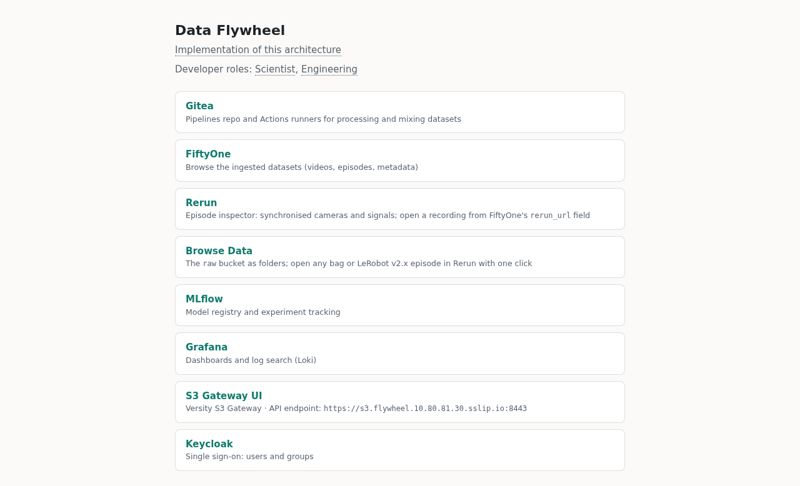

# Quickstart

Connect to the stack from your laptop or a cluster node. You need the account details you were given: your name, a Keycloak password, an MLflow token, an S3 key pair and, to call served models, a Triton token.

## 1. Export the environment

Run this in your clone of this repo (add it to `~/.bashrc` or `~/.zshrc` to keep it), replacing the `<...>` values with your account details. The host settings come from `services/.env.example`.

```bash
eval "$(grep -E '^(SERVICE_NODE|SERVICE_HOST|CADDY_PORT)=' services/.env.example | sed 's/^/export /')"
export FLYWHEEL_CA=~/.flywheel/ca.crt

# S3 (aws CLI, boto3)
export AWS_ACCESS_KEY_ID=<your name> AWS_SECRET_ACCESS_KEY=<your S3 secret> AWS_DEFAULT_REGION=us-east-1
export AWS_ENDPOINT_URL=https://s3.$SERVICE_HOST:$CADDY_PORT AWS_CA_BUNDLE=$FLYWHEEL_CA

# MLflow (Python client)
export MLFLOW_TRACKING_URI=https://$SERVICE_HOST:$CADDY_PORT/mlflow
export MLFLOW_TRACKING_USERNAME=<your name> MLFLOW_TRACKING_PASSWORD=<your MLflow token>
export MLFLOW_TRACKING_SERVER_CERT_PATH=$FLYWHEEL_CA

# Triton (only if you call served models)
export TRITON_URL=triton.$SERVICE_HOST:$CADDY_PORT TRITON_TOKEN=<Triton token>
```

## 2. Set up SSH (from a laptop)

The stack listens on one HTTPS port on `SERVICE_NODE`, reachable through a login node. Skip this section on the cluster itself.

1. Add a host to `~/.ssh/config` that forwards the port (fill in the login node, your user and the values from step 1):
   ```
   Host flywheel
     HostName <login-node>
     User <your cluster user>
     LocalForward 8443 <SERVICE_NODE>:8443
   ```
2. Point the stack's names at the tunnel (once):
   ```bash
   echo "127.0.0.1 $SERVICE_HOST fiftyone.$SERVICE_HOST rerun.$SERVICE_HOST s3.$SERVICE_HOST triton.$SERVICE_HOST llm.$SERVICE_HOST" | sudo tee -a /etc/hosts
   ```
3. Open the tunnel whenever you use the stack:
   ```bash
   ssh -N flywheel
   ```

## 3. Trust the stack's certificate

1. Download it for the command-line tools (step 1 points them at it):
   ```bash
   mkdir -p ~/.flywheel && curl -k https://$SERVICE_HOST:$CADDY_PORT/ca.crt -o $FLYWHEEL_CA
   ```
2. Add it to the system trust store once, so the browser trusts the stack too:
   ```bash
   sudo security add-trusted-cert -d -r trustRoot -k /Library/Keychains/System.keychain $FLYWHEEL_CA   # macOS
   sudo cp $FLYWHEEL_CA /usr/local/share/ca-certificates/flywheel-ca.crt && sudo update-ca-certificates   # Ubuntu
   ```

## 4. Check the connection

Open `https://$SERVICE_HOST:$CADDY_PORT/` and sign in with your name and Keycloak password; one sign-in covers every web app, and the page links to all of them.


