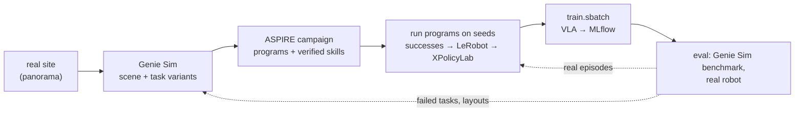

# sensors/autolearn

Robot skills learned by coding agents, then distilled into a VLA: a real site becomes a [Genie Sim](https://github.com/AgibotTech/genie_sim) scene with tasks, [ASPIRE](https://github.com/NVlabs/ASPIRE) agents learn programs that solve them, the programs collect demonstrations, and the flywheel trains and evaluates a VLA on them. Evaluation failures become the next campaign's tasks.



## Layout

Code lives here in git; everything it produces or caches lives in the flywheel, under `$STATE_DIR/autolearn/` (`/tier1/mistral/flywheel/autolearn/`) or in the S3 buckets, never in this checkout. The two upstream submodules stay as published: anything they need changed is wrapped beside them.

| In git (`sensors/autolearn/`) | Contents |
|---|---|
| `aspire/` | [ASPIRE](https://github.com/NVlabs/ASPIRE) (upstream submodule, untouched): coding agents write and debug robot programs; LIBERO-Pro, Robosuite, BEHAVIOR-1K |
| `genie_sim/` | [Genie Sim 3.0](https://github.com/AgibotTech/genie_sim) (upstream submodule, untouched, MPL-2.0): Isaac Sim 5.1 scenes from a panorama, task generation, benchmark, data collection |
| `gb300/` | what runs Genie Sim on the GB300 nodes: `render_bench.py` + `render_bench.sbatch` (rendering speed); planned: `build.sh` (upstream's `Dockerfile.5.1` built for arm64 without the x86 `ik_solver` wheel), `up.sh` (the container on a Slurm GPU, caches on `/tier1`, ROS on domain 42), `ik_shim/` (a drop-in `ik_solver` package that calls `ik_server/` over RPC, [issue 149](https://github.com/AgibotTech/genie_sim/issues/149)) |
| `cap-harness-sandboxed.sh` | ASPIRE's `cap-harness` inside bubblewrap with the user's credentials hidden; what the agent loops run programs through |
| planned: `adapter/` | the Genie Sim adapter for ASPIRE (plan stage 2) and the corobot bridge for XPolicyLab's policy server (stage 5) |
| planned: [`services/gitea/autolearn/`](../../services/gitea/README.md) | the Gitea workflows: scene building (stage 1), `geniesim_to_xpolicylab` (stage 3), `autolearn-cycle` (stage 6), beside the other stages' workflows |

| On the cluster (not in git) | Contents |
|---|---|
| `$STATE_DIR/autolearn/isaac-cache/` | Isaac Sim's kit, shader and Omniverse caches (the first run compiles shaders for minutes; later runs reuse them) |
| `$STATE_DIR/autolearn/logs/`, `results/` | Slurm job logs and the benchmarks' JSON |
| `$STATE_DIR/autolearn/venv-geniesim/` | the Genie Sim CLI venv (`geniesim docker5.1 ...`) |
| `$STATE_DIR/autolearn/campaigns/<campaign>/` | ASPIRE's outputs (`--output-root`): programs, runs, verified skills; scores go to MLflow |
| `$STATE_DIR/hf-home/` | Hugging Face cache shared with the stack (SAM3 weights, ...) |
| `s3://raw/open_datasets/GenieSimAssets/` | Genie Sim's asset pack (29 GB, a pip package), fetched by `download-datasets-hf`; mounted into the container as its assets |
| `s3://raw/internal_datasets/scenes/<site>/` | panoramas of real sites (stage 1) |
| `s3://processed/xpolicylab/geniesim/<task>/` | collected demonstrations after `geniesim_to_xpolicylab` (stage 3), where [`train.sbatch`](../../services/slurm/README.md) reads them |
| MLflow | campaign scores (experiments), VLA checkpoints (registry), evaluation results |

On this laptop (x86_64, no `/tier1`), the same paths sit under `~/.cache/autolearn/` and the `.gitignore`d `hf-cache/`, `.venv-geniesim/`, `isaac-cache/` here.

## Plan

| Stage | Exists | To build |
|---|---|---|
| 1. Real site → scene: panorama into `raw/internal_datasets/scenes/<site>/`; `geniesim_world` (PanoRecon) builds the 3D scene, `geniesim_generator` places objects and writes task variants with success checks | S3, FiftyOne sync; LLM gateway for the generator (`LLM_URL`) | a Gitea workflow on an RTX node; embeddings for the generator's asset search |
| 2. Learn: ASPIRE fix loop per task, in parallel on the GB300; scores to MLflow | ASPIRE on LIBERO (below) | **a Genie Sim adapter for ASPIRE** (`reset`, `step`, observations, success over ROS 2 or the benchmark's inference socket, via `run_program_with_api`): the piece everything else waits on |
| 3. Collect: run verified programs on many seeds, keep successes; `geniesim dataset convert agibot-to-lerobot`; LeRobot → XPolicyLab | [`galaxeaOpenWorldDataset_to_xpolicylab`](../../services/gitea/adapter/README.md) reads LeRobot v2.1 | a `geniesim_to_xpolicylab` adapter workflow (a copy) |
| 4. Train: `train.sbatch <vla> <embodiment> geniesim/<task>` | [slurm](../../services/slurm/README.md) for ACT, DP, MLP | a `models/<vla>/` recipe (XPolicyLab ships `Pi_05`, `GR00T_N17`, `OpenVLA_OFT`, `GalaxeaVLA`) and an embodiment YAML |
| 5. Evaluate: `geniesim benchmark batch` against the served VLA; XPolicyLab real-robot eval; both to MLflow | MLflow, `evaluate.sbatch` | a bridge from XPolicyLab's policy server to Genie Sim's corobot WebSocket (`{"method": "infer"}` → `left_arm`, `right_arm`, `waist`, `head`) |
| 6. Loop: a scheduled workflow reads MLflow, turns failed tasks and layouts (sim and real) into the next campaign's variants and seeds, adds real successes to the training mix, retrains | Gitea Actions, cron | the `autolearn-cycle` workflow |

Models, and where they run:

| Model | Used by | Runs on |
|---|---|---|
| `glm-5.3-flash`, `qwen3.5-122b-a10b` (LLM gateway) | Genie Sim's generator and LLM eval judge | Dynamo (served) |
| `moge-3-vitg`, `llmdet_large`, `sam2.1-hiera-large`, `Qwen-Image-Edit-2511`, `TripoSG` | own assets and scene edits | Triton (served) |
| ml-sharp, DA360 | `geniesim_world` PanoRecon | a batch job on an RTX node |
| Coding-agent LLM | ASPIRE's workers, verifiers, coordinator | Claude Code, or an open coding agent on the LLM gateway |
| SAM3 (gated), Contact-GraspNet, PyRoki, cuRobo | ASPIRE's programs (ports 8114–8116, ASPIRE's own HTTP protocol) | ASPIRE's service stack per node; Triton only with new backends and a client shim |
| The VLA | collection-time eval, deployment | served from MLflow by a Slurm job, behind the corobot bridge |

Decisions to take first: the embodiment (Genie Sim ships the AgiBot G2, Franka, UR5, ARX and Agilex; a Galaxea R1 Pro must be added with Genie Sim's `add-robot` skill), and the licences of SAM3, Contact-GraspNet's PyTorch port, ASPIRE and Genie Sim's assets for derived data.

## Where things run

Isaac Sim rendering (Genie Sim) needs RT cores: on the GB300 nodes (no RT cores, no NGX) Isaac Sim path-traces at about 150 steps in 3 minutes, so Genie Sim's scene building, data collection and benchmarks belong on the `l3-rtx` nodes or this laptop. ASPIRE's agent loops, its perception services, LIBERO (MuJoCo), the LLMs, VLA training and serving run on the GB300. `scene_reconstruction` (CUDA 11.8, Ada only) doesn't run on the GB300 at all.

### Test Genie Sim on the GB300

Isaac Sim's 5.1.0 image is published for arm64, so the build is possible; what to measure is rendering speed. On a GB300 node with Docker and the NVIDIA container toolkit:

1. Build the image (Genie Sim pip-installs Isaac Sim wheels during the build; expect to patch `genie_sim/docker/Dockerfile.5.1` for arm64 wheels).
   ```bash
   A=/tier1/mistral/flywheel/autolearn && uv venv --python 3.12 $A/venv-geniesim && VIRTUAL_ENV=$A/venv-geniesim uv pip install pip -e sensors/autolearn/genie_sim/source/geniesim_cli
   cd sensors/autolearn/genie_sim && GENIESIM_WIP_ACK=1 $A/venv-geniesim/bin/geniesim docker5.1 build
   ```
2. Fetch the assets (29 GB) with the `download-datasets-hf` workflow (repo `agibot-world/GenieSimAssets`, dest `GenieSimAssets`), then start the container headless, with Isaac's caches on `/tier1` and ROS 2 off the robot's domain.
   ```bash
   GENIESIM_ASSETS_SRC=/tier1/mistral/flywheel/versitygw/buckets/raw/open_datasets/GenieSimAssets GENIESIM_CACHE_ROOT=$A/isaac-cache \
     ROS_DOMAIN_ID=42 ROS_LOCALHOST_ONLY=1 $A/venv-geniesim/bin/geniesim docker5.1 up --headless
   $A/venv-geniesim/bin/geniesim docker5.1 into
   ```
3. Inside the container, run one scripted collection task (no policy needed) and time it; the first launch also compiles shaders for several minutes.
   ```bash
   geniesim bootstrap && geniesim status
   time geniesim autocollect run pick_pen_of_specific_color --standalone
   ```

Or measure rendering alone first, without Genie Sim's image (its `ik_solver` wheel is x86-only, [issue 149](https://github.com/AgibotTech/genie_sim/issues/149)): `gb300/render_bench.sbatch` runs `gb300/render_bench.py` in NVIDIA's Isaac Sim 5.1.0 image on a Slurm-allocated GPU, with Genie Sim's renderer settings, and prints steps per second for 1 and 3 cameras. Caches, logs and results go to `/tier1/mistral/flywheel/autolearn/`; the asset pack is `raw/open_datasets/GenieSimAssets` (`download-datasets-hf`).
```bash
sbatch -w <GB300 node> sensors/autolearn/gb300/render_bench.sbatch
```

Decide by steps per second: under about 5 the RTX nodes keep the rendering; above that the GB300 can take data collection too. A render failing with `NGX CreateFeature failed` needs the no-DLSS renderer (FXAA, no DL denoiser, OptiX path tracing), as IsaacLab-Arena needed there (`git show main:sim/isaaclab_arena/hooks/sitecustomize.py`).

## Genie Sim on this laptop

Set up as in the test above (steps 1–2 work unchanged on x86_64; the container runs with host networking and `--privileged`, so keep `ROS_DOMAIN_ID=42` and `ROS_LOCALHOST_ONLY=1`). Pass `--/crashreporter/enabled=false` to any Isaac Sim run you start by hand.

## ASPIRE on LIBERO

1. Initialise the submodule and set the paths (every step below assumes them).
   ```bash
   git submodule update --init sensors/autolearn/aspire
   A=$PWD/sensors/autolearn && cd $A/aspire
   export HF_HOME=$A/hf-cache HF_TOKEN_PATH=~/.cache/huggingface/token
   export LIBERO_CONFIG_PATH=$PWD/.libero TORCH_FORCE_NO_WEIGHTS_ONLY_LOAD=1 MUJOCO_GL=egl PYOPENGL_PLATFORM=egl EGL_PLATFORM=device
   ```
2. Log in to Hugging Face with access to the gated [SAM3](https://huggingface.co/facebook/sam3) weights: `uvx hf auth login`.
3. Install LIBERO and the model services (SAM3, Contact-GraspNet, PyRoki), then start the services on ports 8114–8116.
   ```bash
   scripts/bootstrap_libero.sh
   scripts/bootstrap_providers.sh --providers sam3,contact_graspnet,pyroki --profile rtx5090
   scripts/supervise_services.sh --profile rtx5090 --providers sam3,contact_graspnet,pyroki &
   ```
4. Smoke test: the example program for "pick up the alphabet soup and place it in the basket"; expect `task_success=True`.
   ```bash
   ../cap-harness-sandboxed.sh run --benchmark libero-pro --suite libero_object_swap --task-id 0 --seed 1 --init-mode seeded \
     --program examples/libero/object_swap_seed1.py --output-root outputs/examples --max-steps 2000
   ```
5. Run a campaign: ASPIRE's `iterative-debugging` skill (`aspire/.claude/skills/iterative-debugging/SKILL.md`) with a coding agent as coordinator, `CAP_HARNESS=$A/cap-harness-sandboxed.sh`, and ASPIRE's helper scripts run with `.venv-libero/bin/python`. Expect a task to take about 15 min of Stage 1 (5 dev seeds), 15 min of held-out seeds and 5 min of skill verification on this laptop; `libero_goal_swap` task 0 (open the middle drawer) reached 10/10 held-out.

Notes:
- Pass `--init-mode seeded`: ASPIRE v1.0 crashes resetting LIBERO in the default `saved` mode (`adapter.py` tests a NumPy array with `not`), which also fails `cap-harness doctor --reset` and `validate --plan libero-smoke`.
- Verified skills belong in `aspire/.claude/skills/iterative-debugging/skills/`, a tracked file of the submodule: promote them on a fork, or keep them in the campaign's `outputs/runs/<campaign>/`.
- ASPIRE runs model-generated Python with full access to the machine; the wrapper hides credentials from the programs, not from the agent. Run agent loops on a host without credentials.
- BEHAVIOR-1K (Galaxea R1 Pro) pickups can't run on RTX 50-series GPUs: OmniGibson 3.9.2 drops the cuRobo R1 Pro embodiment ASPIRE plans with.
