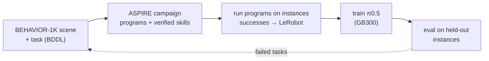
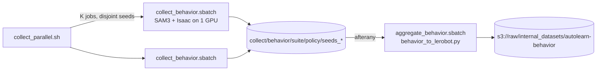

# sensors/autolearn

Robot skills learned by coding agents, then distilled into a VLA: [ASPIRE](https://github.com/NVlabs/ASPIRE) agents learn programs that solve tasks in [BEHAVIOR-1K](https://behavior.stanford.edu/) scenes (OmniGibson on Isaac Sim 5.1, the Galaxea R1 Pro), the programs collect demonstrations, and the flywheel trains and evaluates a VLA (π0.5) on them. Evaluation failures become the next campaign's tasks. When something doesn't work, see [TROUBLESHOOTING.md](TROUBLESHOOTING.md).



## Layout

Code lives here in git; everything it downloads or produces lives in this folder too, in the gitignored state directories below (on the cluster, under `$STATE_DIR/autolearn/` and the buckets instead). The ASPIRE submodule stays as published: anything it needs changed is wrapped beside it.

| In git | Contents |
|---|---|
| `setup.sh` | the whole setup, one subcommand per part: `aspire`, `behavior`, `services` |
| `aspire/` | [ASPIRE](https://github.com/NVlabs/ASPIRE) (upstream submodule): coding agents write and debug robot programs; LIBERO-Pro, Robosuite, BEHAVIOR-1K |
| `adapter/` | BEHAVIOR-1K for ASPIRE: `ik.py` (PyRoki IK on any URDF), `run_behavior.py` (`cap-harness` with PyRoki in place of cuRobo, a post-success grace, the whole-body record, and extra pickup tasks: `picking_up_cup`), `collect_behavior.sh` (a policy over many instances until N successes), `behavior_to_lerobot.py` (runs into a LeRobot v2.1 dataset), `third_person.py` (an extra camera for videos) |
| `adapter/programs/` | `wave.py` (lift, close, open: the smoke test) and the learned R1 Pro programs: `pick_cup_r1pro.py` (the cup pickup), `open_door_r1pro.py`, `go_through_door_r1pro.py` (the latching door) |
| `adapter/pi05/` | π0.5 on the R1 Pro: `r1pro.py` (openpi configs, registered by `run.py`), `to_lerobot.py` (dataset), `norm_stats.py`, `serve_pi05.py` (checkpoint over HTTP), `eval_behavior.py` (an episode against the server) |
| `assets/` | scene changes applied on load, beside upstream's assets: `spring_doors/` (door closers on BEHAVIOR-1K's hinged doors, so the robot has to hold a door open; `BEHAVIOR_SPRING_DOORS=<yaml>` for `run_behavior.py`, tuning in the yaml); `latch_door/` (our own latching door as a BEHAVIOR asset, `door/flylat` in dataset `flywheel-assets`: `make_latch_door.py` writes the URDF, `import_latch_door.py` imports it with OmniGibson's pipeline, `latch.py` drives its closer, latch and lever); `door_room/` (a BEHAVIOR scene of the latching door in a wall, floor and two rooms, `scene_model="door_room"` with `dataset_name="flywheel-assets"`: `make_room_assets.py` imports the floor and walls, `build_door_room.py` writes the scene json and layout maps, `door_room_task.py` registers the `opening_door` BDDL activity, `sample_door_room_task.py` samples and saves its instance) |
| `cap-harness-sandboxed.sh`, `cap-harness-behavior.sh` | ASPIRE's `cap-harness` and the BEHAVIOR runner inside bubblewrap with the user's credentials hidden; agent-written programs run only through these |
| `gb300/` | the GB300 nodes: BEHAVIOR-1K collection as Slurm jobs (`collect_parallel.sh`, `collect_behavior.sbatch`, `aggregate_behavior.sbatch`, `run_behavior.sh`, `behavior.env`); π0.5 (`setup_pi05.sh`, `train_pi05.sbatch`, `eval_pi05.sbatch`, `eval_parallel.sh`) |
| planned: [`services/gitea/autolearn/`](../../services/gitea/README.md) | the Gitea workflows: campaigns and `autolearn-cycle`; [`geniesim_to_xpolicylab`](../../services/gitea/adapter/README.md) (LeRobot to xspark) exists |

| Gitignored state | Contents |
|---|---|
| `hf-cache/` | the Hugging Face cache ASPIRE's services use (SAM3 weights) |
| `cuda-12.8/`, `behavior-data/` | the CUDA toolkit cuRobo compiles against; BEHAVIOR-1K's datasets (~40 GB) |
| `aspire/.venv-*`, `aspire/outputs/` | ASPIRE's venvs (plus `.venv-lerobot`) and every run's artifacts: campaigns under `outputs/runs/`, episodes under `outputs/behavior/`, collections under `outputs/collect/`, datasets under `outputs/datasets/` |

On the cluster the same state sits under `/tier1/mistral/flywheel/autolearn/`, the Hugging Face cache in `$STATE_DIR/hf-home/`, demonstrations in `s3://raw/internal_datasets/autolearn-behavior/<suite>/<policy>/`, and scores, checkpoints and evaluations in MLflow.

## Plan

| Stage | Exists | To build |
|---|---|---|
| 1. Scene and task: a BEHAVIOR-1K scene and a BDDL activity with a success check | BEHAVIOR's scenes and activities; `picking_up_cup`, door tasks and the `door_room` scene beside upstream (`run_behavior.py`, `assets/`) | scenes from real sites |
| 2. Learn: ASPIRE's fix loop per task | BEHAVIOR campaigns (below) | campaigns as Gitea workflows on the GB300; scores to MLflow |
| 3. Collect: run verified programs on many instances, keep successes; LeRobot | `collect_parallel.sh` → `s3://raw/internal_datasets/autolearn-behavior/` | — |
| 4. Train and evaluate π0.5 | `gb300/train_pi05.sbatch`, `gb300/eval_pi05.sbatch` | results to MLflow |
| 5. Loop: failed tasks and instances become the next campaign's seeds, real successes join the training mix | Gitea Actions, cron | the `autolearn-cycle` workflow |

| Model | Used by | Runs on |
|---|---|---|
| Coding-agent LLM | ASPIRE's workers, verifiers, coordinator | Claude Code, or an open coding agent on the LLM gateway |
| SAM3 (gated), Contact-GraspNet, PyRoki | ASPIRE's programs (ports 8114–8116, ASPIRE's own HTTP protocol) | ASPIRE's service stack per node |
| π0.5 | the trained policy | `adapter/pi05/serve_pi05.py` beside the simulator |

Licences: SAM3 is gated; BEHAVIOR-1K's datasets are non-commercial, so demonstrations and models derived from them are too.

On a laptop (RTX 5090, 24 GB) run one Isaac Sim at a time. ASPIRE's agent loops, its perception services, BEHAVIOR collection and π0.5 training and serving also run on the GB300.

## Set up

Needs uv, a Hugging Face login with access to the gated [SAM3](https://huggingface.co/facebook/sam3) weights (`uvx hf auth login`) and, for BEHAVIOR-1K, the CUDA 12.8 runfile (`CUDA_RUNFILE`, default `/tmp/cuda_12.8.1_linux.run`). Each subcommand skips what's already there.

```bash
cd sensors/autolearn
./setup.sh aspire      # LIBERO venv; SAM3, Contact-GraspNet, PyRoki venvs; the LeRobot venv
./setup.sh behavior    # CUDA toolkit, Isaac Sim 5.1 venv, BEHAVIOR datasets (~40 GB; accepts their non-commercial terms)
```

## Run

### ASPIRE on BEHAVIOR-1K (Galaxea R1 Pro)

ASPIRE's own `cap-harness run` on its `BehaviorAdapter` (OmniGibson on Isaac Sim 5.1) with `adapter/ik.py` in place of OmniGibson's cuRobo: `run_behavior.py` is the `cap-harness` command line with the motion providers swapped, `cap-harness-behavior.sh` sandboxes it.

```bash
./setup.sh services
cd aspire && export OMNIGIBSON_HEADLESS=1 OMNIGIBSON_GPU_ID=0 OMNIGIBSON_DATA_PATH=$PWD/../behavior-data OMNIGIBSON_APPDATA_PATH=$PWD/.behavior-appdata && ulimit -c 0
../cap-harness-behavior.sh run --benchmark behavior --suite turning_on_radio --task-id 0 --seed 36 --program ../adapter/programs/wave.py \
    --output-root outputs/behavior --max-steps 600 --camera-width 512 --camera-height 512      # expect program_ok=True, rise_m ≈ 0.08
```

Runs land under `outputs/behavior/` in ASPIRE's [artifact layout](aspire/docs/run-artifacts.md). A cold scene load is ~3 min, warm ~1 min; exit status 139 after `outcome.json` exists is a complete run.

A campaign is ASPIRE's block-by-block skill (`aspire/.claude/skills/iterative-debugging/behavior/SKILL.md`) with `CAP_HARNESS=../cap-harness-behavior.sh`; its shared skill library and per-seed policies accumulate under `aspire/outputs/runs/<stamp>/behavior/`. Tell its workers what differs from their prompt, which assumes cuRobo:

| Worker prompt says | Here |
|---|---|
| `MotionStrategy()` means in-process cuRobo | `pyroki` + ASPIRE's interpolation planner, no collision checking; `ik_solver="curobo"` is refused |
| `max_steps` caps the planned waypoint count, pass 600–900 | ticks of execution; the default 120 is enough for a reach |
| `navigate_to_pose(planner="curobo")` plans the base | no base plan: every leg follows the traversability map in servoed hops; `planner="servo"` drives straight |
| a failed plan costs 6–10 s | IK is milliseconds; reachability is `solve_ik` |

Expect a bootstrap seed to succeed in 10–15 attempts and later seeds, inheriting the library and a policy, in under 10 (`turning_on_radio` seeds 26 and 27 held the radio at attempts 13 and 7).

**Collect demonstrations.** Run a learned policy over fresh instances until enough succeeded, then convert:

```bash
adapter/collect_behavior.sh adapter/programs/pick_cup_r1pro.py 68 299 --target 100 --suite picking_up_cup   # --grace 300 (default): the episode runs on after success
aspire/.venv-lerobot/bin/python adapter/behavior_to_lerobot.py aspire/outputs/collect/behavior/picking_up_cup/pick_cup_r1pro --out aspire/outputs/datasets/behavior_picking_up_cup
aspire/.venv-lerobot/bin/python ../../services/gitea/adapter/geniesim/geniesim_to_xpolicylab.py --raw-dir aspire/outputs/datasets --tasks 'behavior_*' --bench behavior --env-cfg galaxea_r1pro --out aspire/outputs/xspark
```

Seeds are task instances (300 per task; 1–25 are a campaign's evaluation seeds and 36–67 were `pick_cup_r1pro.py`'s development set, so collect from 68). `pick_cup_r1pro.py` (counter search, lift point ahead of the hand) held the cup on 18 of its 32 development instances; misses are mostly the grasp and cups the search never gets near. ASPIRE ends a BEHAVIOR episode the tick the witness sees the object 5 mm up, which would cut every demonstration at the start of the lift; the collector sets `CAP_HARNESS_SUCCESS_GRACE_TICKS` so `run_behavior.py` holds that end off, and the policy lifts the cup 15 cm and keeps it. Each run is a fresh Isaac process, ~3 min; outcomes append to `collect.jsonl` and a rerun resumes. The converter takes the successful runs at the video rate (10 fps, every third tick, the three cameras, 7-joint arms, ASPIRE's 0–1 grippers, end-effector poses in `odom`, and the whole body from `run_behavior.py`'s `episode/whole_body.jsonl`: base pose, base velocity, torso joints and targets; runs without that record are skipped unless `--arms-only`); each demonstration is search, drive, approach, grasp and a 15 cm lift.

**Collect on the GB300 cluster.** Each Slurm job is one GPU with its own SAM3 service and simulator, over a range of task instances; when every job has ended, one more job converts the successful runs and uploads the dataset to `s3://raw/internal_datasets/autolearn-behavior/<suite>/<policy>/`. Set up once from a login node, then submit:

```bash
sensors/autolearn/setup.sh all      # on arm64: BEHAVIOR-1K, SAM3 (HF_TOKEN from services/.env) and LeRobot venvs, datasets, under /tier1/mistral/flywheel/autolearn
sensors/autolearn/gb300/collect_parallel.sh sensors/autolearn/adapter/programs/pick_cup_r1pro.py 68 299 16 500 --suite picking_up_cup
```



- Each job stops at its share of the target or the end of its range; size the range to the policy's success rate. Logs: `/tier1/mistral/flywheel/autolearn/logs/{behavior,sam3,aggregate}-<job>.log`; a rerun of the same range resumes from `collect.jsonl`.
- Policies run without the bubblewrap sandbox (the nodes have none): collect with reviewed programs only, never a campaign's agent-written ones.
- Isaac's caches go to node-local `/tmp/$USER/{behavior-appdata,home}-gpu<N>` and every run gets its own IPC namespace and `/dev/shm` (`run_behavior.sh`): with caches in the NFS home or two runs sharing IPC, concurrent runs hang after "app ready" or fail to load kitchen materials. A cold scene load is ~5 min, ~1.5 min once the GPU's cache is warm; a run that hangs is ended after `BEHAVIOR_RUN_TIMEOUT` (1800 s).

**Train and evaluate π0.5 on the cup collection (GB300).** π0.5 (openpi, XPolicyLab's `policy/Pi_05`; Apache-2.0 code, Gemma-terms weights) trains from the 501 `picking_up_cup` demonstrations in joint space (20 values: arms, grippers, torso) and runs on 22 held-out instances (`$STATE/eval/galaxea/heldout_seeds.txt`), each starting parked where the scripted policy parked (`collect/behavior/picking_up_cup/pick_cup_heldout`). The code is in `adapter/pi05/`.

1. Set up the venv and the base checkpoint: `gb300/setup_pi05.sh`.
2. Convert the dataset and compute its norm stats:
   ```bash
   S=/tier1/mistral/flywheel/autolearn
   HF_LEROBOT_HOME=$S/pi05/lerobot $S/venv-pi05/bin/python adapter/pi05/to_lerobot.py <behavior_to_lerobot dataset> \
       --out $S/pi05/lerobot/r1pro_picking_up_cup
   cd adapter/pi05 && HF_LEROBOT_HOME=$S/pi05/lerobot $S/venv-pi05/bin/python norm_stats.py pi05_r1pro_picking_up_cup
   ```
3. Train: `sbatch gb300/train_pi05.sbatch <run>`. Checkpoints go to `$S/pi05/checkpoints/pi05_r1pro_picking_up_cup/<run>/<step>/`.
4. Evaluate, split over several GPUs (`adapter/pi05/serve_pi05.py` serves the checkpoint, `adapter/pi05/eval_behavior.py` drives the simulator). The jobs share the label's `results.jsonl`; the same command again fills in what is missing:
   ```bash
   gb300/eval_parallel.sh 6 gb300/eval_pi05.sbatch <label> <checkpoint step dir> \
       $S/collect/behavior/picking_up_cup/pick_cup_heldout -- $(cat $S/eval/galaxea/heldout_seeds.txt)
   ```

- Expect the scripted policy on 12 of the 22, the base model on 0, fine-tuned π0.5 on ~8. Single instances vary between runs of the same sampled policy, so compare counts, not instances.
- Checkpoints, datasets and results stay under `$STATE` (`pi05/`, `eval/pi05/<label>/`), never in the submodules.

### ASPIRE on LIBERO

ASPIRE's own path, for comparison and for its skill library. After `./setup.sh aspire`:

```bash
cd aspire && export LIBERO_CONFIG_PATH=$PWD/.libero TORCH_FORCE_NO_WEIGHTS_ONLY_LOAD=1 MUJOCO_GL=egl PYOPENGL_PLATFORM=egl EGL_PLATFORM=device
../cap-harness-sandboxed.sh run --benchmark libero-pro --suite libero_object_swap --task-id 0 --seed 1 --init-mode seeded \
  --program examples/libero/object_swap_seed1.py --output-root outputs/examples --max-steps 2000      # expect task_success=True
```

A campaign is ASPIRE's `iterative-debugging` skill (`aspire/.claude/skills/iterative-debugging/SKILL.md`) with a coding agent as coordinator, `CAP_HARNESS=$A/cap-harness-sandboxed.sh`, and ASPIRE's helper scripts run with `.venv-libero/bin/python`. Expect a task to take about 15 min of Stage 1, 15 min of held-out seeds and 5 min of skill verification on this laptop; `libero_goal_swap` task 0 reached 10/10 held-out.

## Notes

- **Security.** ASPIRE runs model-generated Python with full access to the machine; the `cap-harness-*.sh` wrappers hide credentials with bubblewrap. Run agent-written programs only through them.
- **One Isaac Sim at a time** on a 24 GB GPU.
- **Campaign state** lives under `aspire/outputs/runs/<stamp>/` (gitignored); verified skills belong in `aspire/.claude/skills/iterative-debugging/skills/`, a tracked file of the submodule, so promote them on a fork.
