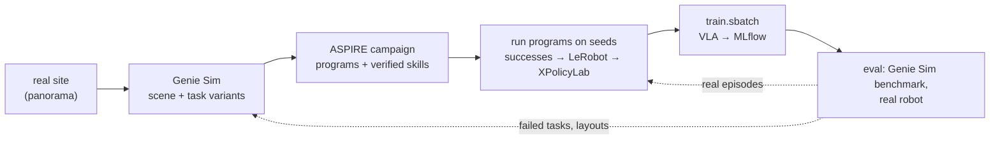

# sensors/autolearn

Robot skills learned by coding agents, then distilled into a VLA: a real site becomes a [Genie Sim](https://github.com/AgibotTech/genie_sim) scene with tasks, [ASPIRE](https://github.com/NVlabs/ASPIRE) agents learn programs that solve them, the programs collect demonstrations, and the flywheel trains and evaluates a VLA on them. Evaluation failures become the next campaign's tasks. When something doesn't work, see [TROUBLESHOOTING.md](TROUBLESHOOTING.md).



## Layout

Code lives here in git; everything it downloads or produces lives in this folder too, in the gitignored state directories below (on the cluster, under `$STATE_DIR/autolearn/` and the buckets instead). The two upstream submodules stay as published: anything they need changed is wrapped beside them.

| In git | Contents |
|---|---|
| `setup.sh` | the whole setup, one subcommand per part: `geniesim`, `aspire`, `behavior`, `services`, `benchmark` |
| `aspire/` | [ASPIRE](https://github.com/NVlabs/ASPIRE) (upstream submodule): coding agents write and debug robot programs; LIBERO-Pro, Robosuite, BEHAVIOR-1K |
| `genie_sim/` | [Genie Sim 3.x](https://github.com/AgibotTech/genie_sim) (upstream submodule, MPL-2.0): Isaac Sim 5.1 scenes, task generation, benchmark, data collection |
| `adapter/` | Genie Sim and BEHAVIOR-1K as ASPIRE environments: `geniesim_adapter.py` (the benchmark's policy socket as ASPIRE's `EnvironmentAdapter`), `ik.py` (PyRoki IK on any URDF), `run_geniesim.py` (a program per episode; `--record` keeps every tick through `record.py`), `run_behavior.py` (`cap-harness` with PyRoki in place of cuRobo), `collect_behavior.sh` (a policy over many instances until N successes), `to_lerobot.py` and `behavior_to_lerobot.py` (recordings and runs into LeRobot v2.1 datasets) |
| `adapter/programs/` | `wave.py` (lift, close, open: the smoke test), `pick_block.py` (hand-written pick), `place_relative.py` (learned pick-and-place), `pick_radio_r1pro.py` (learned R1 Pro radio pickup on BEHAVIOR-1K) |
| `adapter/probes/` | calibration and diagnostic programs and scripts, listed in [TROUBLESHOOTING.md](TROUBLESHOOTING.md) |
| `adapter/tasks/` | benchmark tasks added beside upstream ([README](adapter/tasks/README.md)): a generated layout on the pack's Gaussian-splat laboratory, installed by `install.sh` without editing the submodule |
| `hooks/sitecustomize.py` | on `PYTHONPATH` inside the container: turns Isaac Sim's crash reporter off and registers the tasks in `adapter/tasks/` in the benchmark's code tables |
| `cap-harness-sandboxed.sh`, `cap-harness-behavior.sh`, `cap-harness-geniesim.sh` | ASPIRE's `cap-harness`, the BEHAVIOR runner and the Genie Sim runner inside bubblewrap with the user's credentials hidden; agent-written programs run only through these |
| `gb300/` | Genie Sim's rendering benchmark on the GB300 nodes (`render_bench.py` + `.sbatch`) |
| planned: [`services/gitea/autolearn/`](../../services/gitea/README.md) | the Gitea workflows: scene building (plan stage 1), `autolearn-cycle` (stage 6); [`geniesim_to_xpolicylab`](../../services/gitea/adapter/README.md) exists |

| Gitignored state | Contents |
|---|---|
| `.venv-geniesim/`, `isaac-cache/` | the Genie Sim CLI venv; Isaac Sim's kit, shader and Omniverse caches (the first launch compiles shaders for minutes) |
| `GenieSimAssets/` | Genie Sim's asset pack (29 GB), installed as its `geniesim_assets` package and mounted into the container |
| `hf-cache/` | the Hugging Face cache ASPIRE's services use (SAM3 weights) |
| `cuda-12.8/`, `behavior-data/` | the CUDA toolkit cuRobo compiles against; BEHAVIOR-1K's datasets (~40 GB) |
| `aspire/.venv-*`, `aspire/outputs/` | ASPIRE's venvs (plus `.venv-lerobot`) and every run's artifacts: campaigns under `outputs/runs/`, episodes under `outputs/geniesim/` and `outputs/behavior/`, recordings and datasets under `outputs/recordings/`, `outputs/datasets/` |
| `genie_sim/devel*`, `genie_sim/output/` | the RT Engine's ROS 2 workspace build; the benchmark's evaluation files and review videos |

On the cluster the same state sits under `/tier1/mistral/flywheel/autolearn/`, the asset pack in `s3://raw/open_datasets/GenieSimAssets/` (`download-datasets-hf`), the Hugging Face cache in `$STATE_DIR/hf-home/`, panoramas in `s3://raw/internal_datasets/scenes/<site>/`, recordings in `s3://raw/internal_datasets/geniesim/<task>/`, demonstrations in `s3://processed/xpolicylab/geniesim/<task>/`, and scores, checkpoints and evaluations in MLflow.

## Plan

| Stage | Exists | To build |
|---|---|---|
| 1. Real site → scene: panorama into `raw/internal_datasets/scenes/<site>/`; `geniesim_world` (PanoRecon) builds the 3D scene, `geniesim_generator` places objects and writes task variants with success checks | S3, FiftyOne sync; the generator path ([`adapter/tasks/`](adapter/tasks/README.md) builds a task on the pack's splat laboratory) | a Gitea workflow on an RTX node; embeddings for the generator's asset search; a loader for PanoRecon's Gaussian PLYs (this Genie Sim version loads only backgrounds shipped as USD + `.nurec`) |
| 2. Learn: ASPIRE fix loop per task, in parallel on the GB300; scores to MLflow | ASPIRE on LIBERO; the Genie Sim and BEHAVIOR adapters; a hand-written pick and a learned place on Genie Sim, a BEHAVIOR campaign (below) | campaigns as Gitea workflows; scores to MLflow |
| 3. Collect: run verified programs on many seeds, keep successes; LeRobot → XPolicyLab | `run_geniesim.py --record` + `to_lerobot.py` write LeRobot v2.1, [`geniesim_to_xpolicylab`](../../services/gitea/adapter/README.md) writes xspark | upload recordings to `raw/internal_datasets/geniesim/`; the `agibot_g2` embodiment YAML (7-joint arms) on the XPolicyLab fork |
| 4. Train: `train.sbatch <vla> <embodiment> geniesim/<task>` | [slurm](../../services/slurm/README.md) for ACT, DP, MLP | a `models/<vla>/` recipe (XPolicyLab ships `Pi_05`, `GR00T_N17`, `OpenVLA_OFT`, `GalaxeaVLA`) and the embodiment YAML |
| 5. Evaluate: `geniesim benchmark batch` against the served VLA; XPolicyLab real-robot eval; both to MLflow | MLflow, `evaluate.sbatch` | a bridge from XPolicyLab's policy server to Genie Sim's corobot WebSocket (`{"method": "infer"}` → `left_arm`, `right_arm`, `waist`, `head`) |
| 6. Loop: a scheduled workflow reads MLflow, turns failed tasks and layouts (sim and real) into the next campaign's variants and seeds, adds real successes to the training mix, retrains | Gitea Actions, cron | the `autolearn-cycle` workflow |

Models, and where they run:

| Model | Used by | Runs on |
|---|---|---|
| `glm-5.3-flash`, `qwen3.5-122b-a10b` (LLM gateway) | Genie Sim's generator and LLM eval judge | Dynamo (served) |
| `moge-3-vitg`, `llmdet_large`, `sam2.1-hiera-large`, `Qwen-Image-Edit-2511`, `TripoSG` | own assets and scene edits | Triton (served) |
| ml-sharp, DA360 | `geniesim_world` PanoRecon | a batch job on an RTX node |
| Coding-agent LLM | ASPIRE's workers, verifiers, coordinator | Claude Code, or an open coding agent on the LLM gateway |
| SAM3 (gated), Contact-GraspNet, PyRoki, cuRobo | ASPIRE's programs (ports 8114–8116, ASPIRE's own HTTP protocol) | ASPIRE's service stack per node |
| The VLA | collection-time eval, deployment | served from MLflow by a Slurm job, behind the corobot bridge |

Licences: the asset pack is [CC BY-NC-SA 4.0](https://huggingface.co/datasets/agibot-world/GenieSimAssets), so scenes, demonstrations and models derived from it are non-commercial and share-alike; SAM3 is gated; BEHAVIOR-1K's datasets are non-commercial.

## Where things run

A GB300 GPU renders fast enough for Genie Sim (`gb300/render_bench.sbatch`, Isaac Sim 6.1 from pip, Genie Sim's real-time path tracer without DLSS or the DL denoiser, which need NGX the GB300 lacks): expect ~40 steps/s with one 640x480 camera and ~16 steps/s with three 1280x720 cameras on Isaac's full warehouse; the offline path tracer is the slow one at ~1 step/s. ASPIRE's agent loops, its perception services, LIBERO, the LLMs, VLA training and serving run on the GB300 too. `scene_reconstruction` (CUDA 11.8, Ada only) does not.

```bash
ISAAC_VENV=$PWD/eval/system2/IsaacLab-Arena/.venv sbatch --export=ALL -w <GB300 node> sensors/autolearn/gb300/render_bench.sbatch
```

Isaac Sim's 5.1.0 image is published for arm64, so Genie Sim's image can be built there once `docker/Dockerfile.5.1` is patched for the arm64 Isaac Sim wheels (its `ik_solver` wheel is x86-only, [issue 149](https://github.com/AgibotTech/genie_sim/issues/149)); a render failing with `NGX CreateFeature failed` needs the no-DLSS renderer, as IsaacLab-Arena needed there (`git show main:sim/isaaclab_arena/hooks/sitecustomize.py`).

On a laptop (RTX 5090, 24 GB) run one Isaac Sim at a time: stop the Genie Sim benchmark (`docker exec geniesim3 pkill -f 'geniesim_benchmark/app/app.py'`) before a BEHAVIOR run or an Isaac probe, and the reverse.

## Set up

Needs uv, Docker with the NVIDIA container toolkit, a Hugging Face login with access to the gated [SAM3](https://huggingface.co/facebook/sam3) weights (`uvx hf auth login`) and, for BEHAVIOR-1K, the CUDA 12.8 runfile (`CUDA_RUNFILE`, default `/tmp/cuda_12.8.1_linux.run`). Each subcommand skips what's already there.

```bash
cd sensors/autolearn
./setup.sh geniesim    # CLI venv, asset pack (29 GB), image (~25 min), container, RT Engine workspace (~3 min), hook
./setup.sh aspire      # LIBERO venv; SAM3, Contact-GraspNet, PyRoki venvs; the adapter's packages; the LeRobot venv
./setup.sh behavior    # CUDA toolkit, Isaac Sim 5.1 venv, BEHAVIOR datasets (~40 GB; accepts their non-commercial terms)
```

## Run

### Genie Sim alone

Launch a scene in the RT Engine headless and measure its camera rate.

```bash
docker exec -u $(id -u):$(id -g) -e ROS_DOMAIN_ID=42 -e PYTHONPATH=/home/isaac-sim/.local/hooks -e ISAACSIM_HEADLESS=1 geniesim3 bash -lc \
  'source /opt/ros/jazzy/setup.bash && source /workspace/devel/setup.bash && cd /workspace && ros2 launch genie_sim_bringup app.launch.py scene:=scene_pnp_g2_op launcher_config:=launcher_ovrtx_isaac_physx headless:=true'
docker exec -u $(id -u):$(id -g) -e ROS_DOMAIN_ID=42 geniesim3 bash -lc 'source /opt/ros/jazzy/setup.bash && ros2 topic hz /genie_sim/head_front_camera_rgb/image_raw --window 30'
```

Expect `Isaac Sim physics engine ready` after ~6 min cold (tens of seconds warm), the head camera topic at ~26 Hz and 5.6 GB of GPU memory. Stop it with `docker exec geniesim3 pkill -INT -f "ros2 launch"`; `geniesim docker5.1 down` removes the container (caches and the workspace build stay). Scenes and launchers are YAMLs in `genie_sim/source/geniesim_ros/src/ros_ws/src/genie_sim_bringup/config/`.

### ASPIRE on Genie Sim

The benchmark drives the loop and ASPIRE's program answers as its policy: each episode, `run_geniesim.py` runs the program through ASPIRE's harness with SAM3 and Contact-GraspNet from ASPIRE's services, IK on PyRoki with the G2 URDF and the interpolation planner, and reads success from the benchmark's checks.

1. Start the perception services, the runner, then the benchmark against it:
   ```bash
   ./setup.sh services                                                                    # SAM3 and Contact-GraspNet, ports 8114-8115
   ./cap-harness-geniesim.sh adapter/programs/pick_block.py --config g2op_if_pick_block_color --episodes 4 --debug &
   ./setup.sh benchmark g2op_if_pick_block_color                                           # the benchmark, against port 8999
   ```
2. Read `aspire/outputs/geniesim/<stamp>/episodeNN_taskKK.json`: `program_ok`, `success` (the task's final check), `progress`, `steps`, the program's `result`. `--debug` adds the cameras with the gripper centres projected at every gripper command. The benchmark's own verdict is `genie_sim/output/benchmark/<task>/<sub_task>/evaluate_ret_NN.json`.
3. Stop the benchmark before the next run: `docker exec geniesim3 pkill -f 'geniesim_benchmark/app/app.py'`.

| Program | Task | Expect |
|---|---|---|
| `wave.py` (`--no-providers`) | any | `move_ok` true, `rise_m` ≈ 0.08 |
| `pick_block.py` | `g2op_if_pick_block_color` | the cube held in nearly every episode, `PickUpOnGripper` in most (7 of 8) |
| `place_relative.py` | `g2op_spatial_place_object_relative_position` | end to end in 3–4 of 4 |

Programs are ASPIRE's restricted Python (`import math` only, no names starting with `_`, a top-level `result`) against the tool API in `aspire/docs/api-reference.md`. Keep them within ~330 steps for the pick tasks and ~900 for the place tasks: a gripper command is 25–90 ticks, a move 5–40, and a lift that doesn't finish in budget scores nothing. Robot facts the programs rely on:

| Fact | Value |
|---|---|
| Pinch point | the gripper centre link, 14.3 cm beyond the gripper base along the approach axis; the fingertips meet 1 cm past it |
| Finger opening | 13.6 cm (joint 45°, reported as −0.785); a 5 cm cube is held with the centre link 3.5 cm below its top, fingers parallel to its faces |
| Held reading | 0.12–0.75 of gripper travel (5 cm cube 0.29–0.45, bottle 0.47, apple 0.52, sponge 0.41, 3 cm block 0.18); empty < 0.1 |
| Cameras | head 640×400, wrist 1280×1056, all 1.93 mm focal, square pixels; the head is the reference, the wrist the check |
| Frames | base_link; the checker's `left` is +y, `top` is +x |
| Table | ≈ 0.726 m; in the pick scene the fingers pass through it |

**Learn a skill.** Give a coding agent one task, `aspire/docs/api-reference.md`, `pick_block.py` as the starting point, the commands above and an attempt budget, and have it run its programs only through `cap-harness-geniesim.sh`, keeping each attempt's program, json and `--debug` snapshots and a `notes.md`. Each attempt is one benchmark launch (~1 min to load, then ~1 min per episode); the benchmark serves the same 4 instances every launch. `place_relative.py` took 5 attempts and ~25 min this way. A new task on a new scene: [`adapter/tasks/`](adapter/tasks/README.md).

**Collect a dataset.** Run a scoring program with `--record` and convert the successful episodes:

```bash
./cap-harness-geniesim.sh adapter/programs/place_relative.py --config g2op_spatial_place_object_relative_position --episodes 4 \
    --record aspire/outputs/recordings &
./setup.sh benchmark g2op_spatial_place_object_relative_position
aspire/.venv-lerobot/bin/python adapter/to_lerobot.py aspire/outputs/recordings/g2op_spatial_place_object_relative_position \
    --out aspire/outputs/datasets/g2op_spatial_place_object_relative_position
aspire/.venv-lerobot/bin/python ../../services/gitea/adapter/geniesim/geniesim_to_xpolicylab.py --raw-dir aspire/outputs/datasets --out aspire/outputs/xspark
```

| Step | Writes | Contents |
|---|---|---|
| `--record` | `recordings/<task>/episode_NNNN/` | one frame per tick (trajectories go one tick at a time while recording): the three cameras as the benchmark encoded them, reported joints, targets sent, the outcome |
| `to_lerobot.py` | `datasets/<task>/` | LeRobot v2.1 (LeRobot 0.3.3, the last release writing it), successful episodes only: `observation.images.{head,left_wrist,right_wrist}`, `observation.state`/`action` `.{left_arm,right_arm}` (7 joints), `.{left,right}_gripper`, `.waist`, `.{left,right}_ee_pose`, the instruction as the task |
| `geniesim_to_xpolicylab` | `xspark/geniesim/<task>/agibot_g2/data/episode_NNNNNNN.hdf5` | XPolicyLab's xspark v1.0; on the cluster from `raw/internal_datasets/geniesim/<task>/` to the processed bucket |

Expect ~60 MB of LeRobot and ~45 MB of xspark per 200-frame episode. Training needs a 7-joint `agibot_g2` embodiment on the XPolicyLab fork.

### ASPIRE on BEHAVIOR-1K (Galaxea R1 Pro)

ASPIRE's own `cap-harness run` on its `BehaviorAdapter` (OmniGibson on Isaac Sim 5.1) with `adapter/ik.py` in place of OmniGibson's cuRobo: `run_behavior.py` is the `cap-harness` command line with the motion providers swapped, `cap-harness-behavior.sh` sandboxes it.

```bash
./setup.sh services
cd aspire && export OMNIGIBSON_HEADLESS=1 OMNIGIBSON_GPU_ID=0 OMNIGIBSON_DATA_PATH=$PWD/../behavior-data OMNIGIBSON_APPDATA_PATH=$PWD/.behavior-appdata && ulimit -c 0
../cap-harness-behavior.sh run --benchmark behavior --suite turning_on_radio --task-id 0 --seed 36 --program ../adapter/programs/wave.py \
    --output-root outputs/behavior --max-steps 600 --camera-width 512 --camera-height 512      # expect program_ok=True, rise_m ≈ 0.08
```

Runs land under `outputs/behavior/` in ASPIRE's [artifact layout](aspire/docs/run-artifacts.md). A cold scene load is ~3 min, warm ~1 min; exit status 139 after `outcome.json` exists is a complete run.

A campaign is ASPIRE's block-by-block skill (`aspire/.claude/skills/iterative-debugging/behavior/SKILL.md`) with `CAP_HARNESS=../cap-harness-behavior.sh`; its shared skill library and per-seed policies accumulate under `aspire/outputs/runs/<stamp>/behavior/`. Tell its workers what differs from their prompt, which assumes cuRobo:

| Worker prompt says | Here |
|---|---|
| `MotionStrategy()` means in-process cuRobo | `pyroki` + ASPIRE's interpolation planner, no collision checking; `ik_solver="curobo"` is refused |
| `max_steps` caps the planned waypoint count, pass 600–900 | ticks of execution; the default 120 is enough for a reach |
| `navigate_to_pose(planner="curobo")` plans the base | no base plan: every leg follows the traversability map in servoed hops; `planner="servo"` drives straight |
| a failed plan costs 6–10 s | IK is milliseconds; reachability is `solve_ik` |

Expect a bootstrap seed to succeed in 10–15 attempts and later seeds, inheriting the library and a policy, in under 10 (`turning_on_radio` seeds 26 and 27 held the radio at attempts 13 and 7).

**Collect demonstrations.** Run a learned policy over fresh instances until enough succeeded, then convert:

```bash
adapter/collect_behavior.sh adapter/programs/pick_radio_r1pro.py 46 299 --target 100
aspire/.venv-lerobot/bin/python adapter/behavior_to_lerobot.py aspire/outputs/collect/behavior/turning_on_radio/pick_radio_r1pro --out aspire/outputs/datasets/behavior_turning_on_radio
aspire/.venv-lerobot/bin/python ../../services/gitea/adapter/geniesim/geniesim_to_xpolicylab.py --raw-dir aspire/outputs/datasets --tasks 'behavior_*' --bench behavior --env-cfg galaxea_r1pro --out aspire/outputs/xspark
```

Seeds are task instances (300 per task; 1–25 are a campaign's evaluation seeds and 36–45 were the general policy's development set, so collect from 46). A per-seed campaign policy navigates on new instances but rarely holds (1 of 20); `pick_radio_r1pro.py`, generalized over ten instances, holds on 8 of 10, so expect ~125 runs and ~9 h for 100 demonstrations. Each run is a fresh Isaac process, ~3 min; outcomes append to `collect.jsonl` and a rerun resumes. The converter takes the successful runs at the video rate (10 fps, every third tick, the three cameras, 7-joint arms, ASPIRE's 0–1 grippers, end-effector poses in `odom`); the episode ends on the witness's hold, so each demonstration is search, drive, approach and grasp.

### ASPIRE on LIBERO

ASPIRE's own path, for comparison and for its skill library. After `./setup.sh aspire`:

```bash
cd aspire && export LIBERO_CONFIG_PATH=$PWD/.libero TORCH_FORCE_NO_WEIGHTS_ONLY_LOAD=1 MUJOCO_GL=egl PYOPENGL_PLATFORM=egl EGL_PLATFORM=device
../cap-harness-sandboxed.sh run --benchmark libero-pro --suite libero_object_swap --task-id 0 --seed 1 --init-mode seeded \
  --program examples/libero/object_swap_seed1.py --output-root outputs/examples --max-steps 2000      # expect task_success=True
```

A campaign is ASPIRE's `iterative-debugging` skill (`aspire/.claude/skills/iterative-debugging/SKILL.md`) with a coding agent as coordinator, `CAP_HARNESS=$A/cap-harness-sandboxed.sh`, and ASPIRE's helper scripts run with `.venv-libero/bin/python`. Expect a task to take about 15 min of Stage 1, 15 min of held-out seeds and 5 min of skill verification on this laptop; `libero_goal_swap` task 0 reached 10/10 held-out.

## Conventions

The adapter translates between ASPIRE and Genie Sim; programs see only ASPIRE's side.

| Convention | ASPIRE | Genie Sim benchmark | Adapter |
|---|---|---|---|
| Who drives the loop | the program calls `step()` and gets the next observation | the sim sends an observation and waits for an action chunk | a WebSocket bridge: `step()` answers the pending request with a 1-step chunk and blocks until the next observation |
| Episodes and success | `reset(task, seed)`, a success predicate | episodes from its saved instances; checks scored every 30 steps (`Follow`, `PickUpOnGripper`, `MixedRules`, ...), `episode_done` | `reset()` takes the next episode's first observation after `SETTLE_TICKS`; success = the final check scored |
| Actions | joint positions per tick at `dt = 1/30 s` | absolute joint chunks of length H, one row per sim step | `step()` = H 1; `execute_trajectory()` = one chunk per trajectory (≤ 300 rows), one row at a time when recording; gripper commands held until the reading settles; head joints held at zero |
| Arms | `primary`, `secondary`, 7 joints each | `left_arm`, `right_arm`, 14 joints concatenated left first | primary = left, secondary = right |
| Embodiment | a closed label set | G2 omnipicker | labelled `robosuite` (7-joint arms, several arms allowed) |
| Gripper | 0 closed … 1 open | joint value, about −0.785 open and 0 closed | `g × −0.785` out, `clip(v / −0.785)` in |
| Quaternions | `wxyz` | `xyzw` in `end_pose`; `wxyz` in the USD | reordered where the benchmark's values are read |
| Depth | metres, float, the RGB's size | uint16 millimetres, Z-depth | ÷ 1000, resized if needed |
| Camera frame | x right, y down, z forward | USD camera: −Z forward, +Y up | × `diag(1, −1, −1)` |
| Camera calibration | intrinsics and pose with every observation | not sent | focal length and horizontal aperture from the robot USD (`fy = fx`); pose by FK to the prim's parent link plus the prim's offset |
| End-effector pose | one frame for planning and measurement | `end_pose` from its own FK: the gripper base, 14 cm behind the pinch point | own FK on `gripper_{l,r}_center_link`, the IK target |
| Robot model | whatever the adapter declares | `robot_cfg/G2_omnipicker/G2_omnipicker.urdf`, which doesn't match the simulated robot | the asset pack's `curobo_robot/.../G2_omnipicker_fixed_dual.urdf`, matching to 5 mm |
| IK | the PyRoki service, fixed to the Panda | — | `adapter/ik.py`: PyRoki in-process on the robot's URDF, every joint but the commanded arm's pinned, restarts from jittered seeds |
| Base frame | the adapter's choice | `base_link` | `base_link` |

## Notes

- **Security.** ASPIRE runs model-generated Python with full access to the machine; the three `cap-harness-*.sh` wrappers hide credentials with bubblewrap. Run agent-written programs only through them.
- **One Isaac Sim at a time** on a 24 GB GPU: the Genie Sim benchmark, a BEHAVIOR run and the Isaac probes exclude each other.
- **The benchmark keeps serving** across runner restarts (30 socket retries), so a crashed runner can be relaunched without restarting Isaac Sim.
- **Campaign state** lives under `aspire/outputs/runs/<stamp>/` (gitignored); verified skills belong in `aspire/.claude/skills/iterative-debugging/skills/`, a tracked file of the submodule, so promote them on a fork.
