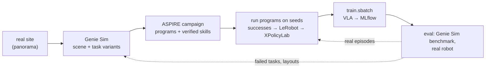

# sensors/autolearn

Robot skills learned by coding agents, then distilled into a VLA: a real site becomes a [Genie Sim](https://github.com/AgibotTech/genie_sim) scene with tasks, [ASPIRE](https://github.com/NVlabs/ASPIRE) agents learn programs that solve them, the programs collect demonstrations, and the flywheel trains and evaluates a VLA on them. Evaluation failures become the next campaign's tasks.



## Layout

Code lives here in git; everything it downloads or produces lives in this folder too, in the gitignored state directories below (on the cluster, under `$STATE_DIR/autolearn/` and the buckets instead). The two upstream submodules stay as published: anything they need changed is wrapped beside them.

| In git | Contents |
|---|---|
| `setup.sh` | the whole setup, one subcommand per part: `geniesim`, `aspire`, `behavior`, `services`, `benchmark` (below) |
| `aspire/` | [ASPIRE](https://github.com/NVlabs/ASPIRE) (upstream submodule, untouched): coding agents write and debug robot programs; LIBERO-Pro, Robosuite, BEHAVIOR-1K |
| `genie_sim/` | [Genie Sim 3.0](https://github.com/AgibotTech/genie_sim) (upstream submodule, untouched, MPL-2.0): Isaac Sim 5.1 scenes from a panorama, task generation, benchmark, data collection |
| `adapter/` | Genie Sim and BEHAVIOR-1K as ASPIRE environments: `geniesim_adapter.py` (the benchmark's policy socket as ASPIRE's EnvironmentAdapter), `ik.py` (PyRoki IK for any URDF), `run_geniesim.py` and `run_behavior.py` (a program per episode), `programs/` (hand-written test programs: `wave.py`, `pick_block.py`, the probes), `probe_server.py` (a hold-still policy), `isaac/` (run inside the container with Isaac's python, benchmark stopped: `finger_probe.py` finger frames at open/half/closed, `grasp_test.py` which cube placements a close holds, `usd_fk_check.py` URDF FK vs the simulator), `joint_probe.py` (one joint at a time against the head camera) |
| `hooks/sitecustomize.py` | turns Isaac Sim's crash reporter off for Genie Sim, which starts `SimulationApp` with no settings: copied into the container and put on `PYTHONPATH` |
| `cap-harness-sandboxed.sh` | ASPIRE's `cap-harness` inside bubblewrap with the user's credentials hidden; what the LIBERO agent loops run programs through |
| `gb300/` | Genie Sim's rendering benchmark on the GB300 nodes (`render_bench.py` + `.sbatch`); planned: the arm64 image build and container launcher |
| planned: [`services/gitea/autolearn/`](../../services/gitea/README.md) | the Gitea workflows: scene building (plan stage 1), `geniesim_to_xpolicylab` (stage 3), `autolearn-cycle` (stage 6) |

| Gitignored state | Contents |
|---|---|
| `.venv-geniesim/`, `isaac-cache/` | the Genie Sim CLI venv; Isaac Sim's kit, shader and Omniverse caches (the first launch compiles shaders for minutes) |
| `GenieSimAssets/` | Genie Sim's asset pack (29 GB), installed as its `geniesim_assets` package and mounted into the container |
| `hf-cache/` | the Hugging Face cache ASPIRE's services use (SAM3 weights) |
| `cuda-12.8/`, `behavior-data/` | the CUDA toolkit cuRobo compiles against; BEHAVIOR-1K's datasets (~40 GB) |
| `aspire/.venv-*`, `aspire/outputs/` | ASPIRE's venvs and every run's artifacts (campaigns under `outputs/runs/`, the adapters' episodes under `outputs/geniesim/` and `outputs/behavior/`), where its scripts put them |
| `genie_sim/devel*`, `genie_sim/output/` | the RT Engine's ROS 2 workspace build; the benchmark's evaluation files |

On the cluster the same state sits under `/tier1/mistral/flywheel/autolearn/` (`isaac-cache/`, `venv-geniesim/`, `campaigns/`, `logs/`, `results/`), the asset pack in `s3://raw/open_datasets/GenieSimAssets/` (`download-datasets-hf`), the Hugging Face cache in `$STATE_DIR/hf-home/`, panoramas in `s3://raw/internal_datasets/scenes/<site>/`, demonstrations in `s3://processed/xpolicylab/geniesim/<task>/`, and scores, checkpoints and evaluations in MLflow.

## Plan

| Stage | Exists | To build |
|---|---|---|
| 1. Real site → scene: panorama into `raw/internal_datasets/scenes/<site>/`; `geniesim_world` (PanoRecon) builds the 3D scene, `geniesim_generator` places objects and writes task variants with success checks | S3, FiftyOne sync; LLM gateway for the generator (`LLM_URL`) | a Gitea workflow on an RTX node; embeddings for the generator's asset search |
| 2. Learn: ASPIRE fix loop per task, in parallel on the GB300; scores to MLflow | ASPIRE on LIBERO; **the Genie Sim adapter** (`adapter/`, below) runs programs on the benchmark's tasks | a first program that passes `pick_block_color`, then campaigns through ASPIRE's `iterative-debugging` skill on it |
| 3. Collect: run verified programs on many seeds, keep successes; `geniesim dataset convert agibot-to-lerobot`; LeRobot → XPolicyLab | [`galaxeaOpenWorldDataset_to_xpolicylab`](../../services/gitea/adapter/README.md) reads LeRobot v2.1 | a `geniesim_to_xpolicylab` adapter workflow (a copy) |
| 4. Train: `train.sbatch <vla> <embodiment> geniesim/<task>` | [slurm](../../services/slurm/README.md) for ACT, DP, MLP | a `models/<vla>/` recipe (XPolicyLab ships `Pi_05`, `GR00T_N17`, `OpenVLA_OFT`, `GalaxeaVLA`) and an embodiment YAML |
| 5. Evaluate: `geniesim benchmark batch` against the served VLA; XPolicyLab real-robot eval; both to MLflow | MLflow, `evaluate.sbatch` | a bridge from XPolicyLab's policy server to Genie Sim's corobot WebSocket (`{"method": "infer"}` → `left_arm`, `right_arm`, `waist`, `head`) |
| 6. Loop: a scheduled workflow reads MLflow, turns failed tasks and layouts (sim and real) into the next campaign's variants and seeds, adds real successes to the training mix, retrains | Gitea Actions, cron | the `autolearn-cycle` workflow |

Models, and where they run:

| Model | Used by | Runs on |
|---|---|---|
| `glm-5.3-flash`, `qwen3.5-122b-a10b` (LLM gateway) | Genie Sim's generator and LLM eval judge | Dynamo (served) |
| `moge-3-vitg`, `llmdet_large`, `sam2.1-hiera-large`, `Qwen-Image-Edit-2511`, `TripoSG` | own assets and scene edits | Triton (served) |
| ml-sharp, DA360 | `geniesim_world` PanoRecon | a batch job on an RTX node |
| Coding-agent LLM | ASPIRE's workers, verifiers, coordinator | Claude Code, or an open coding agent on the LLM gateway |
| SAM3 (gated), Contact-GraspNet, PyRoki, cuRobo | ASPIRE's programs (ports 8114–8116, ASPIRE's own HTTP protocol) | ASPIRE's service stack per node; Triton only with new backends and a client shim |
| The VLA | collection-time eval, deployment | served from MLflow by a Slurm job, behind the corobot bridge |

Decisions to take first: the embodiment (Genie Sim ships the AgiBot G2, Franka, UR5, ARX and Agilex; BEHAVIOR-1K has the Galaxea R1 Pro; a Galaxea R1 Pro in Genie Sim means its `add-robot` skill), and the licences of SAM3, Contact-GraspNet's PyTorch port, ASPIRE and Genie Sim's assets for derived data.

## Where things run

A GB300 GPU renders fast enough for Genie Sim (`gb300/render_bench.sbatch`, Isaac Sim 6.1 from pip, Genie Sim's real-time path tracer without DLSS or the DL denoiser, which need NGX the GB300 lacks): expect ~40 steps/s with one 640x480 camera and ~16 steps/s with three 1280x720 cameras, frames fetched each step, on Isaac's full warehouse; the offline path tracer (16 spp, OptiX-denoised) is the slow one at ~1 step/s. ASPIRE's agent loops, its perception services, LIBERO (MuJoCo), the LLMs, VLA training and serving run on the GB300 too. `scene_reconstruction` (CUDA 11.8, Ada only) doesn't run on the GB300 at all.

```bash
ISAAC_VENV=$PWD/eval/system2/IsaacLab-Arena/.venv sbatch --export=ALL -w <GB300 node> sensors/autolearn/gb300/render_bench.sbatch
```

Isaac Sim's 5.1.0 image is published for arm64, so Genie Sim's image can be built there once `docker/Dockerfile.5.1` is patched for the arm64 Isaac Sim wheels (its `ik_solver` wheel is x86-only, [issue 149](https://github.com/AgibotTech/genie_sim/issues/149)); a render failing with `NGX CreateFeature failed` needs the no-DLSS renderer (FXAA, no DL denoiser, OptiX path tracing), as IsaacLab-Arena needed there (`git show main:sim/isaaclab_arena/hooks/sitecustomize.py`).

## Set up

Needs uv, Docker with the NVIDIA container toolkit, a Hugging Face login with access to the gated [SAM3](https://huggingface.co/facebook/sam3) weights (`uvx hf auth login`) and, for BEHAVIOR-1K, the CUDA 12.8 runfile (`CUDA_RUNFILE`, default `/tmp/cuda_12.8.1_linux.run`). Each subcommand skips what's already there.

```bash
cd sensors/autolearn
./setup.sh geniesim    # CLI venv, asset pack (29 GB), image (~25 min), container, RT Engine workspace (~3 min), hook
./setup.sh aspire      # LIBERO venv; SAM3, Contact-GraspNet, PyRoki venvs; the adapter's packages
./setup.sh behavior    # CUDA toolkit, Isaac Sim 5.1 venv, BEHAVIOR datasets (~40 GB; accepts their non-commercial terms)
```

The asset pack's licence is [CC BY-NC-SA 4.0](https://huggingface.co/datasets/agibot-world/GenieSimAssets): scenes, demonstrations and models derived from it are non-commercial and share-alike; use your own assets for anything else.

## Run

### Genie Sim alone

Launch a scene in the RT Engine headless (the G2 pick-and-place on PhysX) and measure its camera rate.

```bash
docker exec -u $(id -u):$(id -g) -e ROS_DOMAIN_ID=42 -e PYTHONPATH=/home/isaac-sim/.local/hooks -e ISAACSIM_HEADLESS=1 geniesim3 bash -lc \
  'source /opt/ros/jazzy/setup.bash && source /workspace/devel/setup.bash && cd /workspace && ros2 launch genie_sim_bringup app.launch.py scene:=scene_pnp_g2_op launcher_config:=launcher_ovrtx_isaac_physx headless:=true'
docker exec -u $(id -u):$(id -g) -e ROS_DOMAIN_ID=42 geniesim3 bash -lc 'source /opt/ros/jazzy/setup.bash && ros2 topic hz /genie_sim/head_front_camera_rgb/image_raw --window 30'
```

Expect on this laptop (RTX 5090, 24 GB) `Isaac Sim physics engine ready` after ~6 min cold (shader compile; tens of seconds warm), physics at 100 Hz, the render node at its 30 fps target with two cameras (`Render Stats` in the log: ~27 ms a frame, no drops), the head camera topic at ~26 Hz, 5.6 GB of GPU memory. Stop it with `docker exec geniesim3 pkill -INT -f "ros2 launch"`; `geniesim docker5.1 down` removes the container (caches and the workspace build stay). Scenes and launchers are YAMLs in `genie_sim/source/geniesim_ros/src/ros_ws/src/genie_sim_bringup/config/` (`scene_flat_fr3` is a Franka).

### ASPIRE on Genie Sim

The benchmark drives the loop and ASPIRE's program answers as its policy: each episode, `adapter/run_geniesim.py` runs the program through ASPIRE's harness (`run_program_with_api`) with SAM3 and Contact-GraspNet from ASPIRE's services, IK on PyRoki with the G2 URDF and the interpolation planner, and reads success from the benchmark's subtask scores. One Isaac Sim at a time: stop the RT Engine scene first.

```bash
./setup.sh services                                                                    # SAM3 and Contact-GraspNet
aspire/.venv-pyroki/bin/python adapter/run_geniesim.py adapter/programs/pick_block.py --episodes 3 --debug &
./setup.sh benchmark g2op_if_pick_block_color                                           # the benchmark, against port 8999
```

Read `aspire/outputs/geniesim/<stamp>/episodeNN.json`: `program_ok`, `success`, the subtask scores, steps, the program's `result`; `--debug` adds each episode's cameras with the gripper centres projected, at every gripper command (the calibration checks in the notes). `wave.py` (lift the right gripper 8 cm, close, open; no perception, `--no-providers`) ends with `move_ok` true and `rise_m` ≈ 0.08 in ~35 s. `pick_block.py` is the pick in progress (notes below).

### ASPIRE on BEHAVIOR-1K (Galaxea R1 Pro)

The same construction on ASPIRE's own `BehaviorAdapter` (OmniGibson on Isaac Sim 5.1), with `adapter/ik.py` in place of OmniGibson's cuRobo, which drops the R1 Pro embodiment on RTX 50-series GPUs. Base moves use the adapter's `servo` planner.

```bash
./setup.sh services
OMNIGIBSON_GPU_ID=0 aspire/.venv-behavior/bin/python adapter/run_behavior.py adapter/programs/wave.py --task turning_on_radio --seed 1
```

Outcomes in `aspire/outputs/behavior/<stamp>/`. The first launch compiles shaders for several minutes; a cold scene load is ~3 min, warm ~35 s.

### ASPIRE on LIBERO

ASPIRE's own path, for comparison and for its skill library. After `./setup.sh aspire`:

```bash
cd aspire && export LIBERO_CONFIG_PATH=$PWD/.libero TORCH_FORCE_NO_WEIGHTS_ONLY_LOAD=1 MUJOCO_GL=egl PYOPENGL_PLATFORM=egl EGL_PLATFORM=device
../cap-harness-sandboxed.sh run --benchmark libero-pro --suite libero_object_swap --task-id 0 --seed 1 --init-mode seeded \
  --program examples/libero/object_swap_seed1.py --output-root outputs/examples --max-steps 2000      # expect task_success=True
```

A campaign is ASPIRE's `iterative-debugging` skill (`aspire/.claude/skills/iterative-debugging/SKILL.md`) with a coding agent as coordinator, `CAP_HARNESS=$A/cap-harness-sandboxed.sh`, and ASPIRE's helper scripts run with `.venv-libero/bin/python`. Expect a task to take about 15 min of Stage 1 (5 dev seeds), 15 min of held-out seeds and 5 min of skill verification on this laptop; `libero_goal_swap` task 0 (open the middle drawer) reached 10/10 held-out.

## Conventions

The adapter translates between ASPIRE and Genie Sim; programs see only ASPIRE's side.

| Convention | ASPIRE | Genie Sim benchmark | Adapter |
|---|---|---|---|
| Who drives the loop | the program calls `step()` and gets the next observation | the sim sends an observation and waits for an action chunk | a WebSocket bridge: `step()` answers the pending request with a 1-step chunk and blocks until the next observation |
| Episodes and success | `reset(task, seed)`, a success predicate | episodes from its saved instances, ~330 steps each; `task_progress` scores every 30 steps (`Follow`: the gripper-centre link inside the object's box, `PickUpOnGripper`), `episode_done` | `reset()` waits for the next episode's first observation; success = every subtask score ≥ 1 |
| Actions | joint positions per tick at `dt = 1/30 s` | absolute joint chunks of length H, one row per sim step, the arm settled at the chunk's end | `step()` = H 1; `execute_trajectory()` = one chunk per trajectory (≤ 300 rows); gripper commands held 12 ticks |
| Arms | `primary`, `secondary`, 7 joints each | `left_arm`, `right_arm`, 14 joints concatenated left first | primary = left, secondary = right |
| Embodiment | a closed label set (`behavior`, `libero`, `robosuite`, `yam_real`) | G2 omnipicker | labelled `robosuite` (7-joint arms, several arms allowed) |
| Gripper | 0 closed … 1 open | joint value, about −0.785 open and 0 closed | `g × −0.785` out, `clip(v / −0.785)` in |
| Quaternions | `wxyz` | `xyzw` in `end_pose`; `wxyz` in the USD | reordered where the benchmark's values are read |
| Depth | metres, float, the RGB's size | uint16 millimetres, Z-depth (`distance_to_image_plane`) | ÷ 1000, resized if needed |
| Camera frame | x right, y down, z forward | USD camera: −Z forward, +Y up | × `diag(1, −1, −1)` |
| Camera calibration | intrinsics and pose with every observation | not sent | focal length and apertures from the robot USD; pose by FK to the prim's parent link plus the prim's offset |
| End-effector pose | one frame for planning and measurement | `end_pose` from its own FK SDK: the gripper base (flange), 13 cm behind the gripper centre | own FK on `gripper_{l,r}_center_link`, the IK target link |
| Robot model | whatever the adapter declares | `robot_cfg/G2_omnipicker/G2_omnipicker.urdf`, whose torso chain doesn't match the simulated robot | the cuRobo URDF in the asset pack (`GenieSimAssets/robot/curobo_robot/assets/robot/G2/G2_omnipicker_fixed_dual.urdf`) |
| IK | the PyRoki service, fixed to the Panda | — | `adapter/ik.py`: PyRoki in-process on the robot's URDF, every joint but the commanded arm's pinned (the waist is on each arm's chain), seeded from the full joint reading |
| Base frame | the adapter's choice | `base_link` (also `arm_base_link`) | `base_link` |

## Notes

- **Pick.** `pick_block.py` localizes the named block with SAM3 on the head camera (checking the candidate's hue, since SAM3 returns the blue block for "purple block" and the scene's "green" is teal), rises first so the joint-space interpolation doesn't sweep the other blocks, turns the fingers to the cube's faces, descends with a 0–35° tilt (straight down is out of reach for far blocks) aiming 1 cm deeper than the hold window so a low estimate stalls on the table, closes until the fingers stop, reads whether they stopped on the cube (0.25–0.7 of travel) and lifts. Expect it to hold the cube in nearly every episode and score `PickUpOnGripper` in most (7 of 8 in a run; the miss grasped a look-alike block when the arm hid the target from the head camera). Keep programs within ~330 steps (a gripper command is 25–90 ticks, a move 5–40), since a lift that doesn't finish in budget scores nothing.
- **Calibration.** Rerun these checks when the robot model, URDF or camera changes; each compares two independent sources of the same number, and every program below runs through `run_geniesim.py` and reports in its `result`.

  | Check | Program | Sources compared | Expect |
  |---|---|---|---|
  | Kinematic model | `adapter/isaac/usd_fk_check.py` (stop the benchmark first) | our URDF FK vs the simulator's own link poses at saved joint configurations | ≤ 5 mm. The benchmark's `end_pose` is its own FK from the same joints, so agreeing with it proves nothing about the robot |
  | IK + planner closed loop | `programs/wave.py` | commanded 8 cm lift vs the FK-measured rise | `rise_m` ≥ 0.075; a drop means the waist moved (rest cost or seed lost) |
  | Head camera model | any run with `--debug` (`depth_at_centre` in each snapshot's json) | the head depth at the projected gripper *base* (solid, above any block) vs its FK depth; and a block's top from the head vs the height a descent stalls at | equal within 2 cm; the table where the base should be means the camera pose is off. Projecting a point and reading the depth back is blind to a camera rotation, so don't trust that alone. The adapter holds the head joints at zero because the benchmark never reports them |
  | Depth validity | `programs/probe_cloud.py` | head depth image | no zeros or NaNs |
  | Perception to action | `programs/pick_block.py` (`block_head`, `block_wrist`, `held`) | the head and wrist estimates of the block vs each other and vs the stall height | within 2 cm; a held cube reads 0.29–0.45 of gripper travel |
  | Gripper geometry | `adapter/isaac/finger_probe.py`, `grasp_test.py` (stop the benchmark first: one Isaac Sim at a time) | the robot USD driven headless: finger-link meshes in the centre-link frame; a 5 cm cube closed on at offsets, then pulled along the approach | fingertips meet 1 cm past the centre link; a face-aligned cube is held with its top 2.5–4.5 cm above the centre link (joint 0.33–0.45 rad), lost beyond 5 cm or at 30° yaw |

  The wrist cameras' extrinsics from the USD fail the camera check (their own finger links project outside the image): don't localize from them until that's fixed.
- **Genie Sim's benchmark runs one episode per saved instance** and keeps serving episodes across runner restarts (it retries the policy socket 30 times with growing backoff), so a runner can be fixed and relaunched without restarting Isaac Sim. The LLM-task family budgets 200 steps per subtask (`StepOut`).
- **ASPIRE's PyRoki service and client are Panda-only** (`panda_description`, an 8-value seed, the `libero`/`robosuite` embodiments), and its embodiment labels are a closed set; hence `adapter/ik.py` and the `robosuite` label. BEHAVIOR's arm planning is OmniGibson's cuRobo, dropped for the R1 Pro on sm_120 GPUs; the same provider replaces it there.
- **ASPIRE v1.0 on LIBERO:** pass `--init-mode seeded` (the default `saved` mode crashes on reset: `adapter.py` tests a NumPy array with `not`), which also fails `cap-harness doctor --reset` and `validate --plan libero-smoke`. Verified skills belong in `aspire/.claude/skills/iterative-debugging/skills/`, a tracked file of the submodule: promote them on a fork, or keep them in the campaign's `outputs/runs/<campaign>/`.
- **ASPIRE's BEHAVIOR bootstrap** leaves `pyarrow` unpinned and its import check then fails on NumPy 1.x; `setup.sh behavior` pins `pyarrow<23` and reruns it. Its Isaac Sim exit after `validate_behavior.sh` can segfault after the summary is written.
- **Security.** ASPIRE runs model-generated Python with full access to the machine. `cap-harness-sandboxed.sh` hides credentials from LIBERO programs; the Genie Sim and BEHAVIOR runners run programs in-process without a sandbox yet, so hand-written programs only until they're wrapped the same way. The crash-reporter hook covers both of Genie Sim's Isaac interpreters (the pip `isaacsim` and `/isaac-sim`'s `omni_python`); the benchmark's launcher replaces `extra_args`, so the flag doesn't show in its Kit command line, but the plugin isn't loaded.
- **Robot asset facts worth keeping:** the omnipicker's centre link is its pinch point, 14.3 cm beyond the gripper base along +Z (the approach axis): the fingers swing in a near-horizontal arc from 13.6 cm apart (joint 45°, which the benchmark reports as −0.785) to meeting 1 cm past the centre link, so a grasp puts the centre link 3.5 cm below a 5 cm cube's top with the fingers parallel to its faces (`pick_block.py`'s `PAD_OFFSET`, `face_yaw`); a held cube stops the gripper at 0.4–0.55 of its travel, an empty close goes below 0.1; in this scene the fingers pass through the table, so a descent never stalls. Genie Sim's cameras are 1.93 mm focal; Isaac fits the horizontal aperture to the image and the pixels are square (head: 3.896 mm, fx ≈ 317 px at 640 wide; wrist: 3.76 mm, fx ≈ 657 px at 1280 wide; the wrist prims' vertical aperture would give fy 45% too large). The G2's waist joints at rest read about `[-0.83, 1.22, 0.1, 0, 0]`, outside the benchmark URDF's limits, which is how that URDF was found not to match; the data-collection planner's `G2_omnipicker_fixed_dual.urdf` (also in the asset pack under `curobo_robot/`) does.
