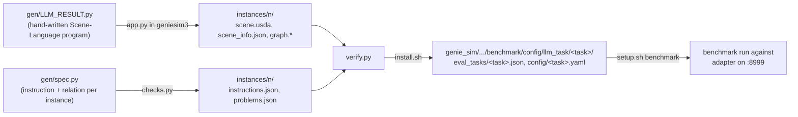

# Benchmark tasks added without touching upstream

Extra Genie Sim 3.2 sub-tasks for the G2 omnipicker, kept here and copied into `genie_sim/` by `install.sh`
(the copies are listed in the submodule's git exclude, so it stays clean).



## Steps

1. Install (copies the files, re-run after regenerating):
   ```bash
   sensors/autolearn/adapter/tasks/install.sh
   ```
2. Run the benchmark on it, with the adapter listening on port 8999 (see `../../README.md`):
   ```bash
   cd sensors/autolearn && ./setup.sh benchmark g2op_spatial_place_object_relative_position_lab
   ```
3. Regenerate the instances (CPU only, in the `geniesim3` container; nothing is downloaded): the four hand-written
   layouts plus seeded random ones up to `LAB_INSTANCES` (objects from the pool, positions in the band, pairs ≥ 0.20 m
   apart, the target strip free). Object ids are re-drawn each run, so `checks.py` and `verify.py` run again; then re-install:
   ```bash
   LAB_INSTANCES=12 sensors/autolearn/adapter/tasks/place_object_relative_position_lab/gen/generate.sh
   ```

## place_object_relative_position_lab

Tabletop instances (four hand-written, the rest seeded random; twelve installed) on the asset pack's Gaussian-splat background (`background/laboratory/laboratory_3`,
a NuRec volume), G2 omnipicker, one instruction each: "place the A to the left/right/top/bottom of the B",
scored like the shipped `place_object_relative_position` (reach A within 300 steps, then A `RelativePosition`
B and `aligned_x|0.1` or `aligned_y|0.1` within 600 steps). Why every number is what it is:
[`place_object_relative_position_lab/NUMBERS.md`](place_object_relative_position_lab/NUMBERS.md).

| Instance | Instruction | Objects on the table |
|---|---|---|
| 0 | place the sponge to the left of the paper cup | cup, sponge, orange, mouse, lemon |
| 1 | place the orange to the right of the lemon | lemon, orange, cup, medicine bottle, sponge |
| 2 | place the paper cup to the top of the sponge | sponge, cup, mouse, lemon, rubik cube |
| 3 | place the lemon to the bottom of the orange | orange, lemon, sponge, medicine bottle, mouse |

| File | Hand-written or generated | Installed to |
|---|---|---|
| `g2op_spatial_place_object_relative_position_lab.yaml` | hand | `<pkg>/config/` |
| `table_task_lab_g2_op.json` | hand (from `table_task_2_g2_op.json`, lab background) | `<pkg>/benchmark/config/eval_tasks/` |
| `instances/<n>/scene.usda`, `scene_info.json`, `graph.dot`, `graph.svg` | generated by `geniesim_generator/app.py` from `gen/LLM_RESULT.py`; `postprocess.py` then makes payload paths absolute and the table kinematic | `<pkg>/benchmark/config/llm_task/place_object_relative_position_lab/<n>/` |
| `instances/<n>/LLM_RESULT.py` | the program that produced it (copy of `gen/LLM_RESULT.py`) | same |
| `instances/<n>/instructions.json`, `problems.json` | hand, via `gen/spec.py` + `gen/checks.py` (fills in the generated object ids) | same |
| `task_info.json` | hand: `{"like": "place_object_relative_position"}`, the shipped task whose robot init states and scoring steps this one takes, applied by `../../hooks/sitecustomize.py` when the benchmark imports its tables (an env without an init state has no `init_arm`) | same |
| `gen/shims/` | stand-ins for `mitsuba`, `pygraphviz`, `jaxtyping`, `transforms3d`, see notes | not installed |

`<pkg>` = `genie_sim/source/geniesim_benchmark/src/geniesim_benchmark`.

Expect the learned `adapter/programs/place_relative.py` to score end to end on about half of these episodes unchanged
(2 of 4 on its first run: both orange/lemon placements; the sponge, 3 cm tall, is the known coin flip at the grasp).

## Notes

- The lab background is the pack's own splat (`common/laboratory_3/splat_7`). A panorama reconstructed with
  `geniesim_world` cannot be loaded by this Genie Sim version; only backgrounds shipped as USD + `.nurec` are.
- The benchmark keys robot init states and scoring steps by sub-task name in code; `task_info.json` plus
  `../../hooks/sitecustomize.py` fill those tables at import, so nothing upstream changes.
- `gen/generate.sh` bridges what the generator's docs leave out (missing packages, import and output paths);
  the list is in [TROUBLESHOOTING.md](../../TROUBLESHOOTING.md).
- Objects start 1 cm above the table top (shipped instances start ~15 cm up and drop). Sizes 3-11 cm,
  all graspable top-down by the 13.6 cm omnipicker; pairs >= 0.20 m apart; the target strip of each
  instruction is kept clear (`gen/verify.py` checks both).
