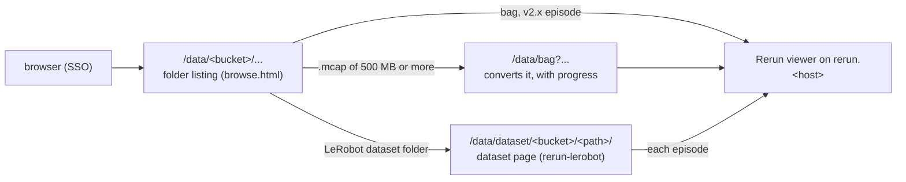

# browse

Browse Data: the `raw` and `processed` buckets as folders at `https://$SERVICE_HOST:$CADDY_PORT/data/`, behind SSO, read-only. Nothing is ingested: it reads the buckets on each visit, so data is viewable as soon as it lands.

1. Open `https://$SERVICE_HOST:$CADDY_PORT/data/` and go to a folder. Bags (`.mcap`, `.bag`) and LeRobot v2.x episodes (under `data/chunk-*`) have an "open in Rerun" link, which opens a new tab. An `.mcap` bag of 500 MB or more, too big for the web viewer as it is, links a page that converts it first and shows the progress ([rerun/](../rerun/README.md), step 4).
2. Open a LeRobot dataset (v2.x or v3) by its **dataset page**: a dataset folder (one holding `meta/`) and its chunk folders link it. It shows the version, robot, frame rate, cameras and signals, and every episode with its task and length, filterable by task, each with an "open in Rerun" link. Up to 2000 episodes a page.

| Piece | Where |
|---|---|
| listing template | `browse.html`, Caddy's `file_server` browse template, mounted at `/etc/caddy/browse` (outside `/srv`, so it is never served) |
| routes | the main host's `/data/`, `/data/dataset/` and `/data/bag` in [`caddy/Caddyfile`](../caddy/Caddyfile) |
| dataset pages, episode recordings, big bags' conversions | `rerun-lerobot` (`lerobot_recording_server.py`, `mcap_recording.py`; [rerun/](../rerun/README.md)) |

**Notes**
- The links carry the path token `RERUN_RAW_TOKEN`, because the viewer fetches files without a login cookie: anyone with a link can read that file. Only Caddy adds the token (into the template, and as `X-Rerun-Token` for the dataset page), so it never leaves the SSO-protected pages.
- After editing `browse.html`, nothing needs restarting: Caddy reads the template on each request.
- `rerun.$SERVICE_HOST/browse/` and `/dataset/` redirect here.
