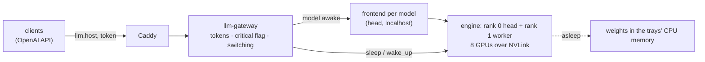

# dynamo

The large LLMs (Kimi K3, GLM-5.3, Inkling) on NVIDIA Dynamo, behind the LLM gateway at `https://llm.$SERVICE_HOST:$CADDY_PORT/v1/`. **Prepared, not yet started**: see [Before the first start](#before-the-first-start).



| | Where |
|---|---|
| etcd, a Dynamo frontend per model, the gateway, rank 0 of each engine | `DYNAMO_HEAD` (02-C03), host network; all but the gateway on 127.0.0.1 |
| rank 1 of each engine (`--headless`) | `DYNAMO_WORKER` (02-C04) |
| weights | the MLflow version each registered model's alias `dynamo` points to, read in place from the mlflow bucket |
| models, images, flags | `models.yaml`; `render.py` writes `$STATE_DIR/dynamo/{head,worker,gateway}.json` |

## Use

1. Get the gateway token (`LLM_TOKEN` in `services/.env`; for mission-critical traffic, `LLM_CRITICAL_TOKEN`) and the stack's CA ([quickstart](../../quickstart.md)).
2. Call it like any OpenAI endpoint; `model` is `kimi-k3`, `glm-5.3` or `inkling`:
   ```bash
   curl --cacert $FLYWHEEL_CA https://llm.$SERVICE_HOST:$CADDY_PORT/v1/chat/completions \
     -H "Authorization: Bearer $LLM_TOKEN" -H 'Content-Type: application/json' \
     -d '{"model": "kimi-k3", "messages": [{"role": "user", "content": "Hello"}]}'
   ```
3. Mark mission-critical requests with `X-Priority: critical` and the critical token: they run ahead of normal requests, and a sleeping model is woken for them at once. With the normal token the flag is ignored.

## Run

1. Register the weights (`download-models-hf`: `Kimi-K3`, `GLM-5.3`, `Inkling-NVFP4`) and point each model's alias `dynamo` at the version to serve.
   ```python
   mlflow.MlflowClient().set_registered_model_alias("Kimi-K3", "dynamo", "1")
   ```
2. Start it: renders the files, starts etcd, the frontends and the gateway, then each model's engine on both trays one at a time, putting all but `default_awake` to sleep (~minutes per model).
   ```bash
   services/ctl.sh dynamo up
   ```
3. Follow it: `services/ctl.sh dynamo ps`, `services/ctl.sh dynamo logs -f engine-kimi-k3`, the worker tray's with `services/ctl.sh dynamo worker logs -f engine-kimi-k3`; the gateway's state at `GET /health` and in Grafana (Prometheus job `llm-gateway`). `services/ctl.sh dynamo down` stops both trays.

## Before the first start

- **Clear the head's GPUs.** Linux file cache fills GB300 GPU memory (it is a NUMA node); an admin drops it once: `sync; echo 3 | sudo tee /proc/sys/vm/drop_caches`. The stack's containers are kept off it since (`ctl.sh`'s `keep_off_gpu_memory`).
- **Check with each model alone first** (set only its alias): untested here are sleep and wake on an engine split over two trays, NVLink across trays from Docker (the IMEX channel device is passed; Dynamo documents it for Kubernetes only), GLM-5.3 on `vllm-runtime:1.5.1` (vLLM 0.28, which pins transformers 5.14.1; vLLM's GLM-5.3 recipe asks for 5.15), and Kimi K3 at TP8 with the `1.5.0-kimi-k3-dev.1` image (Dynamo's GB300 recipe for it uses 4 trays; its TP8 two-tray recipe uses `1.4.0-kimi-k3-dev.1`).
- **Memory:** awake, Kimi K3 takes ~195 GB of each of the 8 GPUs (0.85 of a GB300 with its cache), GLM-5.3 ~95 GB, Inkling ~74 GB. Asleep, a model's weights sit in its trays' CPU memory: Kimi K3 ~780 GB per tray, GLM-5.3 ~380, Inkling ~300; both trays have ~2 TiB.

## Notes

- Switching: a critical request for a sleeping model switches at once (the awake model drains its running requests, then sleeps); a normal one waits until the awake model has been idle 60 s (`IDLE_S`), or until it has waited 10 min (`MAX_WAIT_S`), so normal traffic can't keep the GPUs swapping and no model starves. Expect seconds to wake (weights back over the trays' CPU–GPU link); untimed here.
- Dynamo has no authentication or rate limits of its own; only the gateway listens beyond localhost (`DYNAMO_HEAD:8199`) and it checks the tokens. The engines' system API (sleep, wake, loading artifacts) stays on 127.0.0.1.
- Licences: Inkling Apache-2.0; Kimi K3 and GLM-5.3 have their own (MIT-like, with conditions only for large model-as-a-service businesses).
