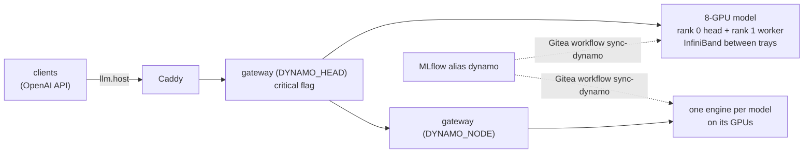

# dynamo

The stack's language models on NVIDIA Dynamo, behind the [LLM gateway](../llm-gateway/README.md) at `https://llm.$SERVICE_HOST:$CADDY_PORT/v1/` (OpenAI API). What is served is set in MLflow: every model whose registered model has the alias `dynamo`, where `models.yaml` places it. Image models and robot policies stay on [Triton](../triton/README.md).



| Model (`model` in requests) | Placement | Notes |
|---|---|---|
| `glm-5.3` | the trays (`DYNAMO_HEAD` + `DYNAMO_WORKER`, 8 GPUs) | one tray model at a time |
| `kimi-k3`, `inkling` | the trays | Kimi K3 with expert parallelism, ~50 tok/s ([Notes](#notes)) |
| `qwen3.5-122b-a10b` | `DYNAMO_NODE` GPU 3 | the sim tools' VLM |
| `qwen3.6-27b`, `qwen3.8-27b` | `DYNAMO_NODE` GPU 2, beside Triton's image models | |
| `qwen3.6-35b-a3b`, `qwen3-vl-8b`, `qwen3.8-flash-next` | `DYNAMO_NODE` GPU 1 | Flash-Next on vLLM 0.31's image |

## Use

1. Get the stack's CA and `LLM_URL` ([quickstart](../../quickstart.md)); no token is needed (only for mission-critical traffic, `LLM_CRITICAL_TOKEN`).
2. Call it like any OpenAI endpoint; `GET /v1/models` lists what is served now:
   ```bash
   curl --cacert $FLYWHEEL_CA $LLM_URL/chat/completions -H 'Content-Type: application/json' \
     -d '{"model": "glm-5.3", "messages": [{"role": "user", "content": "Hello"}]}'
   ```
   ```python
   import os
   from openai import OpenAI, DefaultHttpxClient
   llm = OpenAI(base_url=os.environ["LLM_URL"], api_key="none",   # no token needed
                http_client=DefaultHttpxClient(verify=os.environ["FLYWHEEL_CA"]))   # the stack's CA
   print(llm.chat.completions.create(model="glm-5.3", messages=[{"role": "user", "content": "Hello"}]).choices[0].message.content)
   ```
   Images go in a message as `{"type": "image_url", "image_url": {"url": "data:image/jpeg;base64,..."}}` (Qwen models; at most 4 per request). Reasoning models return their reasoning in `message.reasoning_content`, and it counts towards `max_tokens`; turn it off with `"chat_template_kwargs": {"enable_thinking": false}`.
3. Mark mission-critical requests with `X-Priority: critical` and `Authorization: Bearer $LLM_CRITICAL_TOKEN`: they run ahead of the others in the engine. Without that token the flag is ignored.

A model that isn't served answers `503` with what is; one that is starting (minutes after a change) answers `503` until it's up.

## Serve, swap and stop models

1. Set the alias `dynamo` on the version to serve; remove it to stop serving that model. Moving it between two tray models swaps them.
   ```python
   c = mlflow.MlflowClient()
   c.set_registered_model_alias("GLM-5.3", "dynamo", "1")
   c.delete_registered_model_alias("Kimi-K3", "dynamo")
   ```
2. Dispatch the Gitea workflow `sync-dynamo` ([how](../gitea/README.md)). It stops what lost its alias and starts what gained one; other models keep running. It ends when every served model answers: expect ~7 min for GLM-5.3 (~15 the first time, compiling kernels), a few minutes for the small models. Follow it in the run's log.
3. Or run the same from a shell: `services/ctl.sh dynamo up`.
4. Check a model: `services/ctl.sh dynamo on <node> logs -f engine-<model>` (`dynamo logs` for `DYNAMO_HEAD`, `dynamo worker logs` for `DYNAMO_WORKER`), the gateway's `GET /health`, Grafana **Flywheel → Model usage**.

A sync refuses two tray models at once, and shares over a GPU's budget (`models.yaml` `gpus`); it then serves nothing new until the aliases are fixed. A sync whose model fails to start fails: read the engine's log, fix, then dispatch it again. An engine that dies later stays down until the next sync.

## Add a model

1. Register its weights (`download-models-hf`).
2. Add it to `models.yaml`: name, registered model, image, placement (`trays`, or `{node, gpus, share}` with the share of each GPU's memory it may take), ports no other model uses, flags. Check the shares on its GPUs fit `gpus`.
3. Set its alias (above).

## Before the first start

1. Check the GPUs are free of file cache: `nvidia-smi` should show each GPU's memory free bar its known users. On a GB300 node each GPU's memory is a NUMA node and Linux puts file cache there (shown as used, with no process), and it does not give it back when CUDA allocates. vLLM refuses to start below its share × 276 GiB free. Evict it with `sync; echo 3 | sudo tee /proc/sys/vm/drop_caches` (root).

## Notes

- **`sync-dynamo`** logs in to the service node over ssh as the service account and runs `ctl.sh dynamo up`: `render.py` reads the `dynamo` aliases from MLflow and writes the nodes' compose files, then each node's services are brought up (unchanged ones keep running). Its key (`$STATE_DIR/dynamo/sync_key`, Gitea secret `DYNAMO_SSH_KEY`, made by `ctl.sh up`) is in `~/.ssh/authorized_keys` with that command forced, so it can do nothing else. Only one `up` runs at a time.
- **Linger:** `dynamo up` turns on systemd linger for the service account on every node it uses. Without it logind deletes the engines' `/dev/shm` files whenever the account's last ssh session to a node ends, and the engines die at start (`FileNotFoundError` in `SemLock._rebuild` or `ShmRingBuffer`).
- **Between GPUs:** the NVLink fabric memory (NCCL's MNNVL, NVLS, FlashInfer's MNNVL all-reduce, torch symmetric memory across trays) hangs on rack 02 (`fabric_test/`: rack 01 trays pass), and NCCL's MNNVL hung within one tray too; plain P2P within a tray works (~660 GiB/s). So engines turn those off (`common_env`) and talk between trays over InfiniBand (`/dev/infiniband`, ~210 GiB/s all-reduce bus bandwidth vs ~3 over TCP). FlashInfer's `CUDA_ERROR_NOT_PERMITTED` warning is expected.
- **Host memory:** engines run under `numactl --membind` on the nodes' CPU NUMA nodes (`host_numa_nodes`), so their host buffers and the file cache of the weights they read stay out of the GPUs' memory.
- **Small models' limits:** 32k context, 32 requests at once, 4 images per request (as they had on Triton); without them vLLM's start-up profiling fills the model's share and it fails (`No available memory for the cache blocks`).
- **Kimi K3 runs with expert parallelism** (`--enable-expert-parallel`): split by tensor parallelism at TP8, its MoE tail fusion shares memory over all 8 GPUs (torch symmetric memory), which across trays needs the NVLink fabric, and its start hangs for 10 min, then fails (`DistStoreError ... CUDASymmetricMemory`); vLLM has no switch for the fusion. With EP the experts exchange tokens over InfiniBand: expect ~50 tok/s for one request (~85 on rack 01, where the fabric works). It stays on `vllm-runtime:1.5.0-kimi-k3-dev.1`: Dynamo 1.6's vLLM 0.31 image has no K3 parsers, and its vLLM chat processor refuses K3's config (`--mamba-block-size can only be set with --enable-prefix-caching`).
- **No sleep mode:** models are stopped and started, not slept. vLLM's level-1 sleep garbled GLM-5.3's output after a wake and, with two models asleep, ran the trays out of CPU memory; level 2 with a weight reload worked for GLM-5.3 (~3 min) but Kimi K3's image refuses sleep mode.
- No token and no rate limits: anyone who reaches the stack's port can use these models. Only the gateways listen beyond localhost (port 8199 on each node); etcd, the frontends and the engines' system APIs (stop, sleep, load weights) stay on 127.0.0.1.
- Untested: GLM-5.3 on `vllm-runtime:1.5.1` pins transformers 5.14.1 where vLLM's recipe asks for 5.15 (outputs look right).
- Licences: the Qwen models (but Flash-Next) and Inkling Apache-2.0; Qwen3.8-Flash-Next-NVFP4 the NVIDIA Open Model License; Kimi K3 and GLM-5.3 their own (MIT-like, with conditions only for large model-as-a-service businesses).
