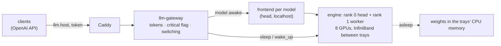

# dynamo

The large LLMs on NVIDIA Dynamo, behind the LLM gateway at `https://llm.$SERVICE_HOST:$CADDY_PORT/v1/`: GLM-5.3 now. Kimi K3 and Inkling are prepared in `models.yaml`; a second model shares the GPUs with GLM-5.3 by switching ([Notes](#notes)).



| | Where |
|---|---|
| etcd, a Dynamo frontend per model, the gateway, rank 0 of each engine | `DYNAMO_HEAD` (02-C03), host network; all but the gateway on 127.0.0.1 |
| rank 1 of each engine (`--headless`) | `DYNAMO_WORKER` (02-C04) |
| weights | the MLflow version each registered model's alias `dynamo` points to, read in place from the mlflow bucket |
| models, images, flags | `models.yaml`; `render.py` writes `$STATE_DIR/dynamo/{head,worker,gateway}.json` |

## Use

1. Get the gateway token (`LLM_TOKEN` in `services/.env`; for mission-critical traffic, `LLM_CRITICAL_TOKEN`) and the stack's CA ([quickstart](../../quickstart.md)).
2. Call it like any OpenAI endpoint; `GET /v1/models` lists the models (`glm-5.3`):
   ```bash
   curl --cacert $FLYWHEEL_CA https://llm.$SERVICE_HOST:$CADDY_PORT/v1/chat/completions \
     -H "Authorization: Bearer $LLM_TOKEN" -H 'Content-Type: application/json' \
     -d '{"model": "glm-5.3", "messages": [{"role": "user", "content": "Hello"}]}'
   ```
   ```python
   import os
   from openai import OpenAI, DefaultHttpxClient
   llm = OpenAI(base_url=os.environ["LLM_URL"], api_key=os.environ["LLM_TOKEN"],
                http_client=DefaultHttpxClient(verify=os.environ["FLYWHEEL_CA"]))   # the stack's CA
   print(llm.chat.completions.create(model="glm-5.3", messages=[{"role": "user", "content": "Hello"}]).choices[0].message.content)
   ```
   GLM-5.3 reasons before it answers: the reasoning comes back in `message.reasoning_content`, and it counts towards `max_tokens`.
3. Mark mission-critical requests with `X-Priority: critical` and the critical token: they run ahead of normal requests, and a sleeping model is woken for them at once. With the normal token the flag is ignored.

## Run

1. Do the steps in [Before the first start](#before-the-first-start) once.
2. Register the weights (`download-models-hf`: `Kimi-K3`, `GLM-5.3`, `Inkling-NVFP4`) and point the alias `dynamo` of each model to serve at its version.
   ```python
   mlflow.MlflowClient().set_registered_model_alias("GLM-5.3", "dynamo", "1")
   ```
3. Start it: renders the files, starts etcd, the frontends and the gateway, then each model's engine on both trays one at a time, putting all but `default_awake` to sleep. Expect ~15 min for a model's first start (compiling kernels) and ~7 min after.
   ```bash
   services/ctl.sh dynamo up
   ```
4. Follow it: `services/ctl.sh dynamo ps`, `services/ctl.sh dynamo logs -f engine-glm-5.3`, the worker tray's with `services/ctl.sh dynamo worker logs -f engine-glm-5.3`; the gateway's state at `GET /health` and in Grafana (Prometheus job `llm-gateway`). `services/ctl.sh dynamo down` stops both trays. `ctl.sh dynamo up` takes no compose arguments; to restart one container, use `services/ctl.sh dynamo restart <service>`.

## Before the first start

1. Turn on systemd linger for the service account on both trays, so logind doesn't delete the engines' shared memory (`/dev/shm` semaphores) whenever your last ssh session to a tray closes. Without it the worker tray's engine dies at start with `FileNotFoundError` in `SemLock._rebuild`.
   ```bash
   for n in $DYNAMO_HEAD $DYNAMO_WORKER; do ssh $n loginctl enable-linger; done
   ```
2. Check the GPUs are free of file cache: `nvidia-smi` should show each GPU's memory free bar the stack's. On a GB300 tray each GPU's memory is a NUMA node and Linux puts file cache there (shown as used, with no process), and it does not give it back when CUDA allocates. vLLM refuses to start below `--gpu-memory-utilization` × 276 GiB free. Evict it with `sync; echo 3 | sudo tee /proc/sys/vm/drop_caches` (root).

## Notes

- **Between GPUs:** the trays' NVLink fabric memory (NCCL's MNNVL, NVLS, FlashInfer's MNNVL all-reduce) hangs NCCL on racks 01 and 02, even within one tray; plain P2P within a tray works (~660 GiB/s). So engines turn those off (`models.yaml` `common_env`) and talk between trays over InfiniBand (`/dev/infiniband`, ~210 GiB/s all-reduce bus bandwidth vs ~3 over TCP). FlashInfer logs `CUDA_ERROR_NOT_PERMITTED` and vLLM falls back; that warning is expected.
- **Host memory:** engines run under `numactl --membind` on the trays' CPU nodes (`host_numa_nodes`), so their host buffers and the file cache of the weights they read stay in CPU memory: unbound, a level-1 sleep's copy of the weights spilled into a GPU's memory and its wake ran out of memory. Each tray has ~955 GiB of CPU memory.
- **Switching:** one model is awake at a time; the gateway puts the others to sleep at level 2 (weights dropped, nothing kept in CPU memory) and, to wake one, reloads its weights from the mlflow bucket. Expect ~3 min for GLM-5.3 (sleep 2 s, wake 6 s, reload 163 s), with output unchanged. A level-1 sleep (weights kept in CPU memory) garbled GLM-5.3's output after the wake and, with two models asleep, ran the trays out of CPU memory (the OOM killer took an engine).
- **Kimi K3 does not start with sleep mode in `vllm-runtime:1.5.0-kimi-k3-dev.1`:** at TP8 its MoE tail fusion refuses sleep mode; at TP4 x PP2 (`models.yaml`) an fp8 KV cache asserts on an fp8 prefill query this image's prefill backend lacks, and a bf16 one fails capturing CUDA graphs (`CUDA error: invalid argument` pinning KDA metadata). Leave its alias unset until an image fixes it; every attempt keeps the trays from GLM-5.3 for ~25 min.
- **Memory:** awake, GLM-5.3 takes ~91 GiB of weights per GPU (8 GPUs) plus KV cache up to its `--gpu-memory-utilization`.
- Untested: GLM-5.3 on `vllm-runtime:1.5.1` pins transformers 5.14.1 where vLLM's recipe asks for 5.15 (outputs look right).
- When the gateway switches: a critical request for a sleeping model switches at once (the awake model drains its running requests, then sleeps); a normal one waits until the awake model has been idle 60 s (`IDLE_S`), or until it has waited 10 min (`MAX_WAIT_S`), so normal traffic can't keep the GPUs swapping and no model starves.
- Dynamo has no authentication or rate limits of its own; only the gateway listens beyond localhost (`DYNAMO_HEAD:8199`) and it checks the tokens. The engines' system API (sleep, wake, loading artifacts) stays on 127.0.0.1.
- Licences: Inkling Apache-2.0; Kimi K3 and GLM-5.3 have their own (MIT-like, with conditions only for large model-as-a-service businesses).
