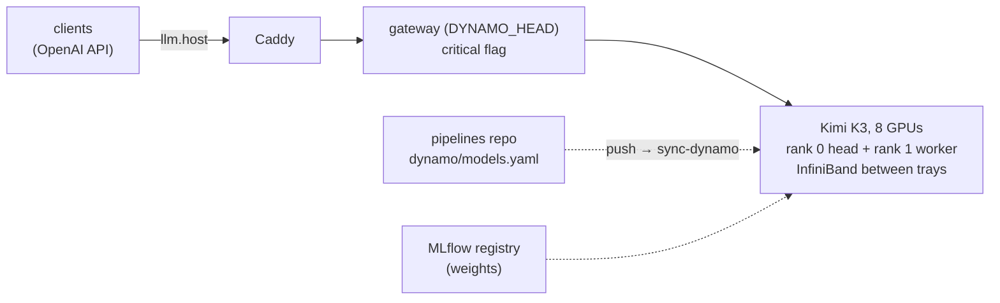

# dynamo

The stack's large language model on NVIDIA Dynamo, behind the [LLM gateway](../llm-gateway/README.md) at `https://llm.$SERVICE_HOST:$CADDY_PORT/v1/` (OpenAI API), on two nodes: the trays `DYNAMO_HEAD` + `DYNAMO_WORKER`. What is served is set by the spec `dynamo/models.yaml` in the Gitea `pipelines` repo: each model with a `version` is served, that version of its MLflow registered model; pushing the spec applies it. The weights must be in the MLflow registry first (an admin registers them). `TRITON_NODE` is Triton's: image models and robot policies are on [Triton](../triton/README.md).



| Model (`model` in requests) | Placement | Context | Notes |
|---|---|---|---|
| `kimi-k3` | the trays (`DYNAMO_HEAD` + `DYNAMO_WORKER`, 8 GPUs) | 256k | images, tools, reasoning; expert parallelism, ~50 tok/s ([Notes](#notes)) |

`GET $LLM_URL/models` lists what answers now. To add a model, see [Add a model](#add-a-model); a tray model takes both trays, so it replaces Kimi K3.

## Use

1. Get the stack's CA and `LLM_URL` ([quickstart](../../quickstart.md)); no token is needed (only for mission-critical traffic, `LLM_CRITICAL_TOKEN`).
2. Call it like any OpenAI endpoint; `GET /v1/models` lists what is served now:
   ```bash
   curl --cacert $FLYWHEEL_CA $LLM_URL/chat/completions -H 'Content-Type: application/json' \
     -d '{"model": "kimi-k3", "messages": [{"role": "user", "content": "Hello"}]}'
   ```
   ```python
   import os
   from openai import OpenAI, DefaultHttpxClient
   llm = OpenAI(base_url=os.environ["LLM_URL"], api_key="none",   # no token needed
                http_client=DefaultHttpxClient(verify=os.environ["FLYWHEEL_CA"]))   # the stack's CA
   print(llm.chat.completions.create(model="kimi-k3", messages=[{"role": "user", "content": "Hello"}]).choices[0].message.content)
   ```
   Images go in a message as `{"type": "image_url", "image_url": {"url": "data:image/jpeg;base64,..."}}` (at most 4 per request). Reasoning models return their reasoning in `message.reasoning_content`, and it counts towards `max_tokens`; turn it off with `"chat_template_kwargs": {"enable_thinking": false}`.
3. Mark mission-critical requests with `X-Priority: critical` and `Authorization: Bearer $LLM_CRITICAL_TOKEN`: they run ahead of the others in the engine. Without that token the flag is ignored.

A model that isn't served answers `503` with what is; one that is starting (minutes after a change) answers `503` until it's up.

## Serve, swap and stop models

1. Edit `dynamo/models.yaml` in the Gitea `pipelines` repo (in the web editor, or a clone) and push to `main`: set a model's `version` to serve that MLflow model version, remove it to stop serving the model, and change its `args` for its engine flags. Moving the version from one tray model to another swaps them.
   ```yaml
   models:
     - name: kimi-k3
       registered: Kimi-K3
       version: 1          # serve v1 of the registered model Kimi-K3; delete this line to stop it
   ```
2. The push runs the Gitea workflow `sync-dynamo` (`gitea_ci/sync-dynamo.yml`; dispatch it by hand to retry, [how](../gitea/README.md)). It checks the spec, stops what lost its version and starts what gained one; other models keep running. It ends when every served model answers: expect several minutes for a tray model (about twice that the first time, compiling kernels). Follow it in the run's log.
3. Or run the same from a shell: `services/ctl.sh dynamo up` (it pulls the spec from Gitea into `$STATE_DIR/pipelines` first).
4. Check a model: `services/ctl.sh dynamo on <node> logs -f engine-<model>` (`dynamo logs` for `DYNAMO_HEAD`, `dynamo worker logs` for `DYNAMO_WORKER`), the gateway's `GET /health`, Grafana **Flywheel → Model usage**.

A sync refuses two tray models at once (each takes all 8 GPUs); it then serves nothing new until the spec gives only one a version. A sync whose model fails to start fails: read the engine's log, fix, then dispatch it again. An engine that dies later stays down until the next sync.

## Add a model

1. Register its weights (`download-models-hf`).
2. Add it to the spec (`dynamo/models.yaml` in the `pipelines` repo): name, registered model, version, image (from `nvcr.io/nvidia/ai-dynamo/`), placement (`trays`; a single-node `{node, gpus, share}` needs a `gpus` budget for that node, and a node that isn't Triton's), ports no other model uses, flags. Check the shares on its GPUs fit `gpus`.
3. Push; the sync starts it (above).

## Before the first start

1. Check the GPUs are free of file cache: `nvidia-smi` should show each GPU's memory free bar its known users. On a GB300 node each GPU's memory is a NUMA node and Linux puts file cache there (shown as used, with no process), and it does not give it back when CUDA allocates. vLLM refuses to start below its share × 276 GiB free. Evict it with `sync; echo 3 | sudo tee /proc/sys/vm/drop_caches` (root).

## Notes

- **`sync-dynamo`** logs in to the service node over ssh as the service account and runs `ctl.sh dynamo up`: it pulls the `pipelines` repo, `render.py` checks its `dynamo/models.yaml` (images from `nvcr.io/nvidia/ai-dynamo/`, known keys only, no `LD_*` or `PYTHON*` env: whoever can push the spec chooses what runs on the GPU nodes), looks up each version's weights in MLflow, and writes the nodes' compose files, then each node's services are brought up (unchanged ones keep running). Its key (`$STATE_DIR/dynamo/sync_key`, Gitea secret `DYNAMO_SSH_KEY`, made by `ctl.sh up`) is in `~/.ssh/authorized_keys` with [`tools/bin/dynamo-up`](../../tools/bin/README.md) forced, so it can do nothing else. Only one `up` runs at a time.
- **Linger:** `dynamo up` turns on systemd linger for the service account on every node it uses. Without it logind deletes the engines' `/dev/shm` files whenever the account's last ssh session to a node ends, and the engines die at start (`FileNotFoundError` in `SemLock._rebuild` or `ShmRingBuffer`).
- **Between GPUs:** the NVLink fabric memory (NCCL's MNNVL, NVLS, FlashInfer's MNNVL all-reduce, torch symmetric memory across trays) hangs on rack 02 (rack 01 trays pass), and NCCL's MNNVL hung within one tray too; plain P2P within a tray is used, and can break on its own: check a tray with [`nvlink_test/`](nvlink_test/README.md) before serving on it. So engines turn those off (`common_env`) and talk between trays over InfiniBand (`/dev/infiniband`, ~210 GiB/s all-reduce bus bandwidth vs ~3 over TCP). FlashInfer's `CUDA_ERROR_NOT_PERMITTED` warning is expected.
- **Host memory:** engines run under `numactl --membind` on the nodes' CPU NUMA nodes (`host_numa_nodes`), so their host buffers and the file cache of the weights they read stay out of the GPUs' memory.
- **Kimi K3 runs with expert parallelism** (`--enable-expert-parallel`): split by tensor parallelism at TP8, its MoE tail fusion shares memory over all 8 GPUs (torch symmetric memory), which across trays needs the NVLink fabric, and its start hangs for 10 min, then fails (`DistStoreError ... CUDASymmetricMemory`); vLLM has no switch for the fusion. With EP the experts exchange tokens over InfiniBand: expect ~50 tok/s for one request (~85 on rack 01, where the fabric works). Its frontend uses Dynamo's own chat processor: vLLM's (Dynamo 1.6's vLLM 0.31 image) refuses hybrid linear-attention configs like K3's and GLM-5.3-Flash's (`--mamba-block-size can only be set with --enable-prefix-caching`).
- **No sleep mode:** models are stopped and started, not slept. vLLM's level-1 sleep garbled a model's output after a wake and, with two models asleep, ran the trays out of CPU memory; Kimi K3's image refuses sleep mode.
- No token and no rate limits: anyone who reaches the stack's port can use these models. Only the gateways listen beyond localhost (port 8199 on each node); etcd, the frontends and the engines' system APIs (stop, sleep, load weights) stay on 127.0.0.1.
- Licence: Kimi K3 its own (modified MIT, with conditions only for large model-as-a-service businesses).
