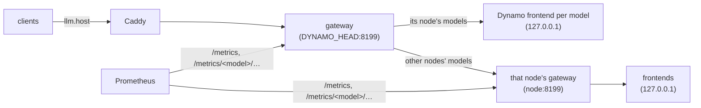

# llm-gateway

The one OpenAI-compatible endpoint for the language models [Dynamo](../dynamo/README.md) serves, at `https://llm.$SERVICE_HOST:$CADDY_PORT/v1/` (`gateway.py`, aiohttp, no state). No token is needed.



| Endpoint | What |
|---|---|
| `POST /v1/chat/completions`, `/v1/completions`, `/v1/responses`, ... | forwarded to the frontend of the body's `model`, streams included; `503` for a known model that isn't served now or is starting, `404` for an unknown one |
| `GET /v1/models` | the served models: ready, context window, licence, about, inputs (images and how many, tools, reasoning); the landing page's model table reads it (`/status/models`) |
| `GET /health` | each served model: up or not |
| `GET /metrics` | Prometheus (jobs `llm-gateway`, `dynamo`): requests per model and class, in flight, up |
| `GET /metrics/<model>/frontend`, `/engine` | that model's Dynamo frontend and vLLM engine metrics, relayed from 127.0.0.1 for Prometheus (job `dynamo`) |

## Use

Call it like any OpenAI endpoint ([dynamo/](../dynamo/README.md#use)). To run a request ahead of the others, send `X-Priority: critical` with `Authorization: Bearer $LLM_CRITICAL_TOKEN` (`services/.env`); the gateway turns it into Dynamo's request priority, and ignores the flag without that token.

## Run

It runs and updates with Dynamo: `ctl.sh dynamo up` (also run by the Gitea workflow `sync-dynamo`) builds the image (`Dockerfile`) and starts a gateway on every node that serves a model, plus on `DYNAMO_HEAD` always.

```bash
services/ctl.sh dynamo logs -f gateway                       # DYNAMO_HEAD's
services/ctl.sh dynamo on <node> logs -f gateway             # another node's
```

## Notes

- Its config, `$STATE_DIR/dynamo/<node>.gateway.json`, is written by `dynamo/render.py` from `dynamo/models.yaml` and the MLflow aliases: each model's frontend and system API, or the gateway it lives behind, and its details. A changed config restarts the gateway (its environment carries the config's hash).
- It keeps Dynamo off the network: Dynamo has no authentication, so its frontends, etcd and the engines' system APIs (stop, sleep, load weights) listen on 127.0.0.1 only, and the gateway is what listens on the node's address.
- Each request is counted by the gateway on the model's node; `DYNAMO_HEAD`'s only forwards other nodes' requests, so the counts in Prometheus aren't doubled.
- Env: `GATEWAY_CONFIG`, `GATEWAY_LISTEN` (host:port), `LLM_CRITICAL_TOKEN`.
- To check whether the gateways or Caddy slow a model down, run [`profile/`](profile/README.md): it times the same request through every hop. They add a few ms to the first token and nothing to the decode speed.
