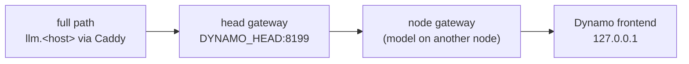

# profile

How much Caddy and the LLM gateways add to a model's speed. It sends the same streamed request through each path, from the outside in, all from the node that serves the model, so only the hops differ between rows.



1. Run it for a served model (`GET $LLM_URL/models` lists them), on a login node with `services/.env` and `$STATE_DIR/flywheel.env` readable; about 10 s for a small model, 30 s for Kimi K3.
   ```bash
   services/llm-gateway/profile/profile.sh qwen3.6-35b-a3b
   ```
2. Compare each row with the last one (the model's own frontend):

| Column | What |
|---|---|
| First token | median time to the first streamed token, of 5 requests after a warm-up |
| Total | median time to the last token (128 tokens) |
| Decode | completion tokens per second after the first token |

Expect the decode speed to be the same on every row and the first token 1-3 ms later per gateway and 4-7 ms later through Caddy (`qwen3.6-35b-a3b`: 46 ms at the frontend, 50 ms on the full path, 302 tok/s throughout). A row much slower than the one below it points at that hop; slow on every row points at the engine or its load instead.

**Notes**
- The requests are real: a busy model shows its queue in every row, so profile when it's quiet, or repeat and compare.
- Each row is one `bench.py` run (standard library only); run it alone to time any OpenAI-compatible URL: `python3 bench.py <label> <base url> <model> [CA file]`.
