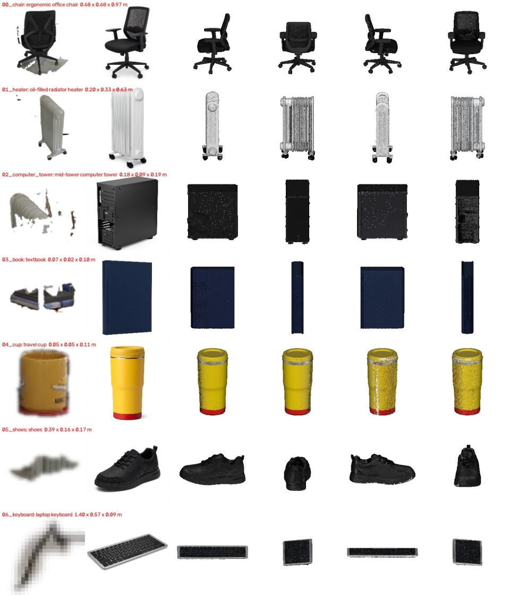
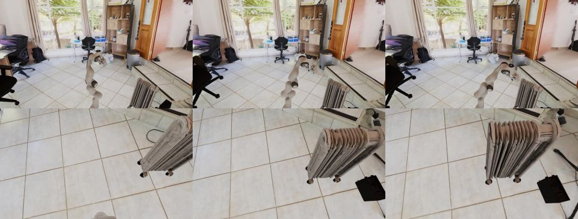

# sim/asset_gen

The objects of a [`pano_ideate`](../pano_ideate/README.md) session as textured rigid bodies, generated rather than reconstructed: a typical object of its kind in the session's colours, at the session's size and place. The room around them is [`colmap_splat`](../colmap_splat/README.md#from-a-pano_ideate-session)'s.

```mermaid
flowchart LR
  C["session's view<br/>(small, partly hidden)"] --> N["VLM: what it is,<br/>a typical one, its colours"]
  N --> D["editor: a clean<br/>product drawing"]
  D --> M["SAM cutout → TripoSG<br/>shape"]
  M --> R["grey renders<br/>from 5 sides"]
  R --> P["editor paints each<br/>(colours in words)"]
  P --> T["bake: 1024 px texture"]
  T --> F["fit: session's height,<br/>turn and place"]
  F --> U["model.usda + texture.png<br/>model.glb, pose.json"]
```





## Run it

1. Download a session from the pano_ideate viewer (`<scene>_session.zip`).
2. Set up the model endpoints (below).
3. Generate the objects: tick them in the checklist (objects generated before start unticked; ~4 min each).
   ```bash
   uv run sim/asset_gen/objects.py <scene>_session.zip
   ```

`--asset <name>` (repeat; `00_chair` or `chair`) skips the checklist, and a run outside a terminal generates every object. `--seed <n>` draws another one.

| File in `datasets/asset_gen/<scene>/objects/<asset>/` | What |
|---|---|
| `model.usda`, `texture.png` | USD, z up, metres, origin at the centre of the base: a rigid body with convex-decomposition collision, a mass, a `UsdPreviewSurface` reading the texture |
| `model.glb` | the same mesh as glTF (y up) |
| `pose.json` | where it stands and how it is turned in the scene frame, its size and mass, what it was generated as |
| `views/` | the session's view, the drawing, each side's render and painting: look here first when an object is wrong |

## In IsaacLab-Arena



1. Make the background a textured mesh room (the erased panorama on its depth; renders on any GPU, where colmap_splat's splat needs RT cores).
   ```bash
   uv run sim/asset_gen/background.py <scene>_session.zip
   ```
2. Write an Arena spec of the objects where the session saw them (position and yaw), with a Franka at the capture point picking one and placing it at another; it prints the environment to export.
   ```bash
   uv run sim/asset_gen/arena.py datasets/asset_gen/<scene> --pick 04_cup --place 03_book
   ```
3. Record it ([isaaclab_arena](../isaaclab_arena/README.md#record-a-demo); on a GB300, see [Which GPU](../isaaclab_arena/README.md#which-gpu)).
   ```bash
   bash sim/isaaclab_arena/envgen.sh record --env_spec datasets/asset_gen/<scene>/arena.yaml --video_dir <dir>
   ```

Notes:
- The room is a static collider, so objects rest on its counters; it shows the photo as it is (emissive), whatever the sim's lights. View it from near the capture point: further away, what the panorama never saw shows.
- The robot spawns at the panorama's capture point (`ARENA_SPLAT_ORIGIN='0 0'`), and each object stands where the session saw it, turned by its `pose.json` yaw. A capture point next to a counter puts the robot's base against it.

## Model endpoints

| Variable | Default model | Used for | Licence |
|---|---|---|---|
| `VLM_ENDPOINT` | Qwen3.5-122B-A10B | what the object is, its colours in words | Apache-2.0 |
| `EDIT_ENDPOINT` | Qwen-Image-Edit-2511 | the drawing, the paintings | Apache-2.0 |
| `SEGMENT_ENDPOINT` | sam2.1-hiera-large | cutouts, checking each painting's outline | Apache-2.0 |
| `MESH_ENDPOINT` | TripoSG | the shape | MIT |

Set each as in [pano_ideate](../pano_ideate/README.md#model-endpoints). The texture unwrap is [xatlas](https://github.com/jpcy/xatlas) (MIT), run locally.

## Notes

- **Generated, not a copy:** labels, dents and dirt are dropped and hidden parts invented; the VLM keeps the label's kind of object.
- **Size:** an object seen in part (a chair behind a table) is scaled to the part seen; check `size_m` in `pose.json`.
- **Texture:** the editor is given only the grey render and the colours in words (given the drawing too, it redraws the drawing's pose). A painting whose outline overlaps its render under 0.8 is dropped (good ones 0.94–0.99); what no view sees (an underside) takes the nearest painted colour. Paintings ask for flat light, since Isaac Sim lights the asset itself.
- **Fit:** scaled to the measured height, turned in 5° steps until its silhouette from the capture point matches the last-seen 3D points (`silhouette_overlap` in `pose.json`; low means a poor turn).
- **Mass:** 400 kg/m³ over the convex hull, 0.02–50 kg; set it in `model.usda` when you know it.
- Articulated objects (the zip's `articulated/`) are not generated yet.
