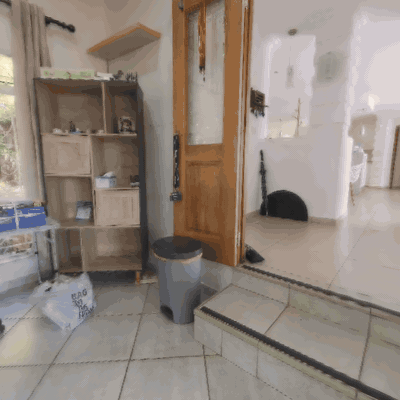
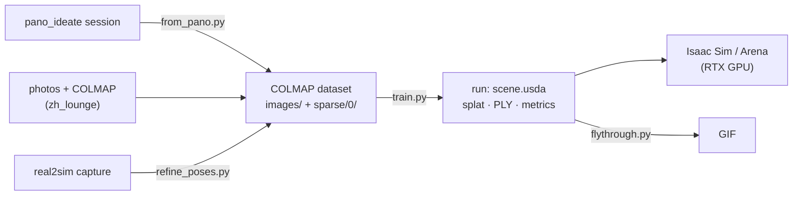

# sim/colmap_splat

Gaussian splats of real rooms for Isaac Sim and IsaacLab-Arena backgrounds, trained with [3DGRUT](https://github.com/nv-tlabs/3dgrut) (3DGUT + MCMC, the trainer behind NVIDIA NuRec; an untouched submodule at `sim/colmap_splat/3dgrut`). Data lives in `datasets/colmap_splat/` (gitignored).





## Install (once)

Install 3DGRUT into its venv (~20 GB, x86_64 or aarch64), on a machine with an NVIDIA GPU (on the cluster, a GPU node with many cores).

```bash
bash sim/colmap_splat/install.sh
```

## Train

| Input | Commands |
|---|---|
| A [`pano_ideate`](../pano_ideate/README.md) session (the office above; ~7 + 9 min) | `uv run sim/colmap_splat/from_pano.py <scene>_session.zip datasets/colmap_splat/<scene>`<br>`uv run sim/colmap_splat/train.py datasets/colmap_splat/<scene> datasets/colmap_splat/<scene>/runs --floor` |
| A COLMAP dataset: NVIDIA's zh_lounge (gated: accept the terms, `hf auth login`) | `uvx hf download nvidia/PhysicalAI-Robotics-NuRec --repo-type dataset --include 'zh_lounge/*' --local-dir datasets/colmap_splat/zh_lounge`<br>`uv run sim/colmap_splat/train.py datasets/colmap_splat/zh_lounge/zh_lounge/colmap datasets/colmap_splat/zh_lounge/runs` |
| A [`sensors/real2sim`](../../sensors/real2sim/README.md) capture: refine the robot's poses first (x86_64 only; ~5 min for 1000 images) | `uv run sim/colmap_splat/refine_poses.py datasets/real2sim/run1/colmap datasets/real2sim/run1/colmap_refined`<br>`uv run sim/colmap_splat/train.py datasets/real2sim/run1/colmap_refined datasets/real2sim/run1/runs --floor` |
| Any of these on the S3 gateway ([client setup](../../services/versitygw/README.md#client-setup)) | `uv run sim/colmap_splat/train.py s3://raw/open_datasets/nurec-zh_lounge/zh_lounge/colmap s3://processed/splats/zh_lounge` |

Then look at it (on the GPU machine; the camera circles the dataset's mean camera centre, `--centre x y z` to choose):

```bash
uv run sim/colmap_splat/flythrough.py datasets/colmap_splat/<scene>/runs/<scene>/<run> <scene>.gif
```

`train.py <input> <output> [3DGRUT overrides]` runs upstream's `apps/colmap_3dgut_mcmc.yaml` (`--config`) with USD and PLY export; every 8th image is held out and scored; `n_iterations=7000` makes a quick check. It needs no Slurm: on the cluster, run it over SSH on a node with a free GPU (`CUDA_VISIBLE_DEVICES`).

## Output

| `<output>/<name>/<run>/` | What |
|---|---|
| `scene.usda` | **open this one**: the splat (`splat.usdc`) in the dataset's frame, Z-up, gaussians beyond `--crop_radius` (30 m) dropped; with `--floor`, an invisible collision floor at z = 0 under the cameras plus 2 m |
| `export_last.ply` | the standard 3DGS PLY for other viewers (uncropped) |
| `export_last_lightfield.usdz` | the raw export: normalised frame (Y-up) and wrong camera FOV, so don't reference it |
| `metrics.json`, `ckpt_last.pt` | held-out PSNR/SSIM/LPIPS; the checkpoint (`flythrough.py`, `export_ply.py`) |

As an Arena background: [isaaclab_arena](../isaaclab_arena/README.md#notes). Gaussian splats need RT cores to render, so not on the GB300 nodes; there, use [asset_gen's mesh room](../asset_gen/README.md#in-isaaclab-arena).

## Notes

- **Expect:**
  - **office pano:** 30 dB / 0.88 SSIM held out at the default 30k iterations in ~9 min on a GB300 (30 dB at 7k in ~3 min).
  - **zh_lounge:** ~27 dB / 0.92 SSIM at 30k in ~19 min (GB300; ~31 min on an RTX 5090 Laptop), ~25 dB at 7k in ~5 min plus a few minutes of JIT compile on a machine's first run.
  - **real2sim ridgeback_demo (1008 images, 7k):** 17.4 dB with a pinhole lens and localisation poses, 18.9 with the right lens, 33.1 / 0.96 with refined poses.
- **Pano datasets:** 26 views from the capture point cut from the panorama, and 288 from points up to 0.6 m around it drawn from its depth, with OpenCV filling what the panorama never saw (`--fill editor`: Qwen-Image-Edit for views over 1% missing, ~10 s each, `EDIT_ENDPOINT`). Starting points: 600k from the depth. The splat holds up within ~0.6 m of the capture point; the frame is the session's (metric, z up, origin on the floor below the capture point).
- **Frames:** metric and gravity-aligned only if the poses are (real2sim's `map` frame, pano sessions); plain SfM datasets like zh_lounge need placing by hand.
- **Keep the default settings:** 60k iterations, weaker penalties, PPISP and 2–3M gaussians didn't improve held-out quality on zh_lounge; improve the capture (coverage, lens model, poses) instead.
- **Large captures:** with 500+ images `train.py` lowers MCMC's opacity and scale penalties to 0.001 (the default 0.01 lets a 1000-image capture collapse); override with `loss.lambda_opacity=` / `loss.lambda_scale=`. `strategy.add.max_n_gaussians` (1M) only limits growth; on a 24 GB GPU stay at or below ~2M.
- **refine_poses.py:** matches each image with its nearest views (GPU SIFT), triangulates from the input poses, bundle-adjusts poses and points with the lenses fixed and maps the result back onto the input centres (it stays in the map frame). Check its last lines: median reprojection error well under 1 px. A few cm and a degree of pose error blur a splat more than any training setting.
- **S3:** inputs are mirrored into `datasets/colmap_splat/cache/inputs/` (changed files only), outputs trained in `cache/runs/` and uploaded to `<output>/<name>/<run>/`. Real2sim captures go to `s3://raw/internal_datasets/real2sim/<name>/colmap/` (refined: `colmap_refined/`, its `sparse/` and `images/`).
- **Install:** the CUDA toolkit lands in the venv (no host `nvcc`; on aarch64 assembled from NVIDIA's redist tarballs); CUDA 13.0 for sm_103 (GB300), else 12.8 (`CUDA_VERSION` to force); on aarch64 OpenUSD is built into `.venv/opt/usd` (~10 min); `DISPLAY` is unset during it (the runfile would open an xterm). The venv has absolute paths baked in: don't move the checkout. A run trained without PLY export gets one with `cd sim/colmap_splat/3dgrut && source .venv/bin/activate && python ../export_ply.py <run dir>`.
- **Your own scenes:** lock focus, exposure and white balance; 300–500 overlapping stills per room at the robot cameras' heights; no people or moving objects; clear what the robot will manipulate; a few markers of known size. Pose them with COLMAP or GLOMAP (not set up here), real2sim, or one panorama (pano_ideate).
- **Planned:** automated workcell capture: a robot maps the cell, captures from planned viewpoints, trains, and re-plans where held-out PSNR is low.
