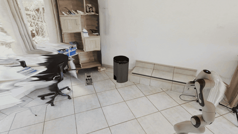
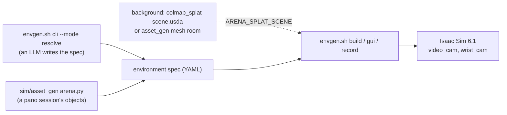

# sim/isaaclab_arena

Helpers around the [IsaacLab-Arena](../../eval/system2/README.md) submodule: generate environments with an LLM, put them in captured or generated rooms, record scripted demos. Nothing here modifies the submodule; `hooks/sitecustomize.py` adds to it from outside.





## Run

The office above, end to end from a [pano_ideate](../pano_ideate/README.md) session (`asset_gen` objects, its [mesh room](../asset_gen/README.md#in-isaaclab-arena)):

```bash
uv run sim/asset_gen/background.py datasets/pano_ideate/office/session.zip
uv run sim/asset_gen/arena.py datasets/asset_gen/office --pick 04_cup --place 03_book   # prints the exports below
export ARENA_SPLAT_SCENE=$PWD/datasets/asset_gen/office/background/scene.usda ARENA_ASSET_DIR=$PWD/datasets/asset_gen/office/objects ARENA_SPLAT_ORIGIN='0 0'
bash sim/isaaclab_arena/envgen.sh record --env_spec datasets/asset_gen/office/arena.yaml --video_dir datasets/videos/office \
  --num_steps 150 --eye -1.2 -1.0 1.6 --target 1.0 0.8 0.6 --kit_args --/crashreporter/enabled=false
```

Generate an environment with an LLM ([CLIProxyAPI](https://github.com/router-for-me/CLIProxyAPI) for `resolve` and the GUI; `build` needs only Isaac Sim). Specs go to [`eval/system2/environments/`](../../eval/system2/environments/) unless `--out_dir` is given.

```bash
export OPENAI_API_KEY=<proxy client key>
bash sim/isaaclab_arena/envgen.sh cli --mode resolve --prompt "Franka at a table in the splat_scene warehouse ..."
bash sim/isaaclab_arena/envgen.sh cli --mode build --env_spec eval/system2/environments/<env>.yaml
bash sim/isaaclab_arena/envgen.sh gui        # live editor on http://localhost:8501
```

Record a real2sim splat scene with the mobile manipulator (an RTX GPU):

```bash
export ARENA_SPLAT_SCENE=datasets/real2sim/run1/runs/colmap/<run>/scene.usda
bash sim/isaaclab_arena/envgen.sh record --env_spec eval/system2/environments/ridgeback_mug_to_bowl_splat_scene.yaml \
  --video_dir datasets/videos/ridgeback_demo --num_steps 460 --eye -1.7 0.8 1.6 --target 3.0 -0.1 0.6
```

`record` writes `video_cam/clip_0000.mp4` (fixed at `--eye`, looking at `--target`) and `wrist_cam/clip_0000.mp4` at 15 fps: a scripted sweep for checking a scene, not a policy (the arm dips to the task's pick and place objects and circles; nothing is grasped).

## Which GPU

| GPU | Meshes: robot, objects, mesh rooms | Gaussian splat backgrounds |
|---|---|---|
| RTX (e.g. the 5090 laptop) | yes | yes |
| GB300 nodes (`CUDA_VISIBLE_DEVICES` = a GPU Triton leaves free) | yes, path traced (~3 min for 150 steps with start-up) | no: `Ray query is not supported` (no RT cores) |

On a GB300, run it over SSH, one Isaac Sim at a time:
```bash
ssh $SERVICE_NODE "bash -lc 'cd ~/workspaces/data-flywheel && CUDA_VISIBLE_DEVICES=3 bash sim/isaaclab_arena/envgen.sh record --env_spec <spec.yaml> --video_dir <dir> --kit_args --/crashreporter/enabled=false'"
```

## Variables

| Variable | Does | Default |
|---|---|---|
| `OPENAI_API_KEY`, `ARENA_PROXY_BASE_URL`, `ARENA_PROXY_MODEL` | the LLM proxy (`cliproxy` endpoint) | (required), `http://127.0.0.1:8317/v1`, `claude-sonnet-5-5` |
| `ARENA_SPLAT_SCENE` | a background `scene.usda` ([colmap_splat](../colmap_splat/README.md) splat or [asset_gen](../asset_gen/README.md) mesh room), registered as `splat_scene` (`ARENA_SPLAT_NAME` renames it) | none |
| `ARENA_SPLAT_ORIGIN` | `"x y"` in the background's frame where the robot spawns (Arena's origin) | the centre of its floor |
| `ARENA_ASSET_DIR` | an asset_gen `objects/` folder, each object registered as `gen_<asset>` | none |
| `ARENA_NO_DLSS` | `1`/`0` forces the no-DLSS renderer (FXAA, no DL denoiser, path tracing with OptiX), which the hook picks itself on GPUs without NGX (GB300, B200, H100, A100: every frame otherwise fails, `NGX CreateFeature failed`, and the camera read crashes); `ARENA_NO_DLSS_RENDER=rtpt` keeps the real-time path tracer (grainier) | by GPU name |

## Notes

- **Backgrounds:** a splat or mesh room only renders, its lighting baked. Its collision is an invisible floor (the capture's footprint plus 2 m; a mesh room is also a collider). Anchor on it with an object reference (`parent_id: <background id>`, `prim_path: floor`), place a table `on` it and objects on the table; [`franka_mug_to_bowl_splat_scene.yaml`](../../eval/system2/environments/franka_mug_to_bowl_splat_scene.yaml) pins the table with `at_position`. Camera coordinates are Arena's, so a framing fits one background; keep the camera inside the captured area (floaters crowd its edges).
- **Mobile manipulator:** `ridgeback_franka_ik` is `franka_ik` on Isaac Lab's holonomic Ridgeback (`RIDGEBACK_FRANKA_PANDA_CFG`): `franka_ik`'s 7 action values, then base `vx, vy` (m/s) and `wz` (rad/s), on joints anchored at the spawn pose (so in that fixed frame). `record` drives it `--stop_x` (1.05 m) towards the table first; `franka_ik` specs skip the driving.
- `record.py` writes its frames itself: Isaac Lab's `VideoRecorder` (moviepy 1.0.3) duplicates and drops a frame every ~7.
