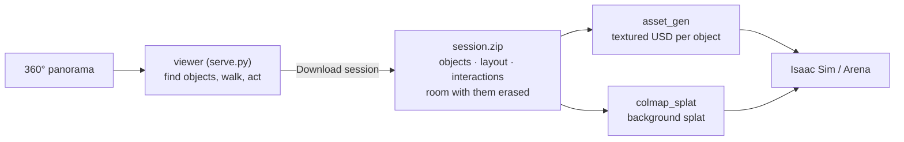

# sim/pano_ideate

Turn one 360° photo of a room into a simulation scene: find its objects and act on them in the browser, then generate them as textured rigid bodies and the room around them as a Gaussian splat.




Every model runs on [Triton](../../services/triton/README.md): the viewer and `asset_gen` run anywhere that reaches it, a laptop included; only the splat training needs a GPU.

## Run it

1. Set up the model endpoints (below).
2. Start the viewer, open `http://localhost:8765` and add a panorama in the panel (~2 min: its depth).
   ```bash
   uv run sim/pano_ideate/serve.py
   ```
3. In **1 · Objects**, drag a box over part of the room, then **Find all objects** (~20 s) or type one thing's name and **Find it**. Click an object to rename or remove it. Every object you find is an asset of the session: generated by `asset_gen` and erased from the background.
4. In **2 · Act**, click an object. Tick **Take into the inventory** to erase it into the inventory, or give it a **mode**: name it, and the first time say in the **director prompt** how it looks (the image editor draws it). After that, click the mode's preview to switch back to how it was last seen in it, exactly; × deletes a mode it is not in. The **action** is recorded in the session as said. Then **Download session**.

   | Click | Then | Action | Director prompt |
   |---|---|---|---|
   | the cup | tick **Take into the inventory** | pick up the cup | |
   | the bin | mode `open`; its mode now `closed` | open the bin lid | the bin lid is open, showing an empty inside |
   | the cup in the inventory, then the bin | | put the cup in the bin | in the bin |
   | the bin | its `closed` preview | close the bin lid | |
   | the door | mode `closed`; its mode now `open` | close the door | close the double doors: the two door leaves now fill the doorway, and the wall beside the doorway is bare |
5. Generate the objects, ticking them in the checklist (~4 min each; [asset_gen](../asset_gen/README.md)).
   ```bash
   uv run sim/asset_gen/objects.py <scene>_session.zip
   ```
6. Generate the background on a machine with an NVIDIA GPU (~7 + 3 min; [colmap_splat](../colmap_splat/README.md#train)).
   ```bash
   uv run sim/colmap_splat/from_pano.py <scene>_session.zip datasets/colmap_splat/<scene>
   uv run sim/colmap_splat/train.py datasets/colmap_splat/<scene> datasets/colmap_splat/<scene>/runs --floor
   ```

| Output | Where | What |
|---|---|---|
| Objects | `datasets/asset_gen/<scene>/objects/<asset>/model.usda` | a textured rigid body, origin at the centre of its base |
| Layout | `layout.json` in the zip | each object's x, y now (null if picked up and not put back) |
| Interactions | `interactions.json` in the zip | pick-ups, placements, mode changes, in order, each with its action, director prompt and where the agent (the viewer's eye) stood: `agent` x, y, z, yaw, pitch |
| Modes | `objects/<asset>/modes/<mode>.jpg` in the zip | each mode as last seen, and its area on the panorama (`.npz`) |
| Background | `datasets/colmap_splat/<scene>/runs/.../scene.usda` | the room without the objects |

All in the scene frame: z up, metres, origin on the floor below the capture point.

Check before use:
- **Background:** open the zip's `background/pano.jpg`; an object left there (the export logs `WARNING: the <object> may still be in the background`) appears twice.
- **Objects:** open each one's `views/`; `--seed <n>` draws another.
- **Heights:** `layout.json` has no height, and an object seen in part (a chair behind a table) is sized to that part. Stand each asset on the surface below it.

## Model endpoints

| Variable | Default model | Used for | Licence |
|---|---|---|---|
| `VLM_ENDPOINT` | Qwen3.5-122B-A10B | finding objects, describing them to the editor | Apache-2.0 |
| `EDIT_ENDPOINT` | Qwen-Image-Edit-2511 | drawing modes, erasing and placing objects | Apache-2.0 |
| `DEPTH_ENDPOINT` | moge-3-vitg | metric depth | MIT |
| `DETECT_ENDPOINT` | llmdet_large | finding missed objects (`objects.py` only) | Apache-2.0 |
| `SEGMENT_ENDPOINT` | sam2.1-hiera-large | outlining objects | Apache-2.0 |

Leave a variable unset for the default model on the flywheel Triton (`triton.$SERVICE_HOST:$CADDY_PORT`, or `TRITON_URL`), or set it to another model name or a full URL, `https://<host:port>/v2/models/<model>`. Reach Triton as in [quickstart.md](../../quickstart.md) steps 1–3; to serve a model elsewhere, see [Triton](../../services/triton/README.md#serve-a-model).

## The viewer

| Do | How | Expect |
|---|---|---|
| Look, move, zoom | drag; WASD or arrows; scroll | within 0.4 m of the capture point (the circle; `--radius`): further, holes show |
| Find objects | **1 · Objects**: drag a box (right-drag looks around), **Find all objects**, or name one thing and **Find it** | ~20 s, ~3 s; ones already found are skipped |
| Rename or remove an object | **1 · Objects**: click it | one you have acted on can't be removed |
| Act on an object | **2 · Act**: hover (an object with modes is cyan), click, take it into the inventory or give it a mode | ~30 s; ~1 s to switch to a mode seen before |
| Put back | pick it in the inventory, click where it goes, type the action and how it stands there | ~35 s |
| Look back | **Action history**: hover a step for its details, click it (or `[` `]`) to see the room after it; Undo, Reset | |
| Download session | the panel | ~30 s per group of nearby objects erased, plus a retry for each still seen |

Notes:
- The state is saved to `<scene>/edits/` after every edit and resumed on restart; Reset deletes it. `session.py <scene>` writes the zip without the viewer. `--host 0.0.0.0` serves other machines.
- An object with two modes is an articulated one. Each mode is remembered as last seen, contents included: open the bin, put the cup in, close it, open it, the cup is there. Switching puts back the mode's pixels and depth exactly.
- Director prompts for modes: say the end state and what moves away or appears ("the two door leaves now fill the doorway, and the wall beside the doorway is bare"); "the leaves swing shut" alone left the open leaves on the walls.

## The steps by hand

The viewer runs these; run one by hand to check or redo it.

| Step | Command | Check |
|---|---|---|
| Depth and scene frame (~2 min) | `uv run sim/pano_ideate/depth.py datasets/pano_ideate/<scene>` | `depth/floor.png`: walls straight, floor flat |
| All objects at once, instead of the viewer's rectangles (~5 min) | `uv run sim/pano_ideate/objects.py datasets/pano_ideate/<scene>` | `objects/labels.jpg` |
| An action's end state | `uv run sim/pano_ideate/act.py datasets/pano_ideate/<scene> "open the cupboard"` | `act/<action>/crops/` |
| The session zip | `uv run sim/pano_ideate/session.py datasets/pano_ideate/<scene>` | `background/pano.jpg` in it |

The panorama goes at `datasets/pano_ideate/<scene>/source.jpg`. The sample, `office`, is a Poly Haven HDRI (CC0):
```bash
mkdir -p datasets/pano_ideate/office && curl -fL -o datasets/pano_ideate/office/source.jpg \
  "https://dl.polyhaven.org/file/ph-assets/HDRIs/extra/Tonemapped%20JPG/poly_haven_studio.jpg"
```

Notes:
- The scale is MoGe's estimate (camera 1.2 m above the floor for `office`); `depth.py --camera_height <m>` sets it.
- Every object is just an object: what happens to it is the action's. The list is `objects/objects.json` (the viewer's Objects tool writes it and keeps the first one as `objects.detected.json`); expect odd names from detection, and rename them.
- `objects.py --redetect` and `act.py --replan` ask the models again instead of reusing their cache.
