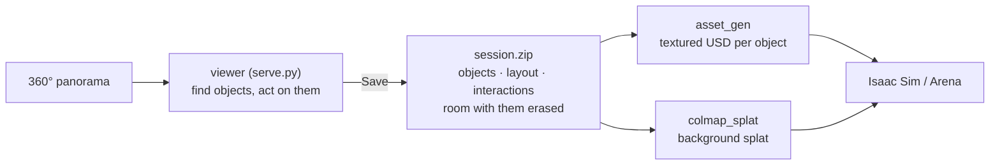

# sim/pano_ideate

Turn one 360° photo of a room into a simulation scene: find its objects and act on them in the browser, then generate them as textured rigid bodies and the room around them as a Gaussian splat.




Every model runs on [Triton](../../services/triton/README.md): the viewer and `asset_gen` run anywhere that reaches it, a laptop included; only the splat training needs a GPU.

## Run it

1. Set up the model endpoints (below).
2. Start the viewer, open `http://localhost:8765` and drop a panorama on the start card (~2 min: its depth), or a session downloaded before. The viewer holds one scene; its state is saved on the server after every edit, so it survives closing the browser.
   ```bash
   uv run sim/pano_ideate/serve.py
   ```
3. In **Objects**, make the scene; none of it is recorded as an action.
   - Drag a box round an object. **Object**: type its **Name** and **Find it** (SAM outlines it, ~3 s); its **Mode** is the state it is in, `default` unless you name one. Every object you find is an asset of the session: generated by `asset_gen` and erased from the background.
   - Or **Image**: say what fills the box, optionally with a reference image (a photo of the room behind a door), and the image editor paints it in (~1 min); a prompt that erases, removes or clears something edits the box as it is instead. Then **Keep** it or **Discard** it.
   - Click an object for its **Object Editor**: rename or remove it, and set its modes, as in the Action Editor but not recorded. Pick **New**, a name and a **director prompt** (what moves, what it shows or hides) to draw a mode (~30 s; the object stays as it is). Pick a mode to have the object found in it, with a director prompt to redraw it there (~30 s). × deletes a mode. An object you have acted on switches in **Act** only.
4. In **Act**, click an object for its **Action Editor**: pick where the action takes it (one of its modes, as last seen, or **Take** into the inventory, which erases it), type the **action** (recorded in the session as said) and **Apply** (~1 s to switch, ~30 s to take). Going to a mode (or staying in it), you can also pick up to 2 items from its **Inventory** and give a **director prompt**: the image editor redraws it so (~30 s), which is how that mode is seen from then on. Then **Download** (top right) downloads the session zip for the next steps; drop it on the start card to open the scene again where you left off. **×** clears the scene and starts over.

   The office above (the sample below):

   | Where | Box or click | Then | Action / director prompt |
   |---|---|---|---|
   | Objects | box the bin | **Mode** `closed`, **Name** `bin` | |
   | Objects | box the bag | **Name** `plastic bag of rubbish` | |
   | Objects | box the doors | **Mode** `open`, **Name** `wooden doors` | |
   | Objects | the bin | **New** `open` | the bin lid is open, showing an empty inside |
   | Objects | the doors | **New** `closed` | close the double doors: the two door leaves now fill the doorway, and the wall beside the doorway is bare |
   | Act | the bag | **Take** | pick up the plastic bag of rubbish |
   | Act | the bin | `open` | open the bin lid |
   | Act | the bin | `open`, **Inventory**: the bag | put the bag in the bin; the plastic bag of rubbish lies inside the open bin |
   | Act | the bin | `closed`, then `open` | close the bin lid; open it: the bag is still there |
   | Act | the doors | `closed` | close the doors |
5. Generate the objects, ticking them in the checklist (~4 min each; [asset_gen](../asset_gen/README.md)).
   ```bash
   uv run sim/asset_gen/objects.py <scene>_session.zip
   ```
6. Generate the background on a machine with an NVIDIA GPU (~7 + 9 min; [colmap_splat](../colmap_splat/README.md#train)).
   ```bash
   uv run sim/colmap_splat/from_pano.py <scene>_session.zip datasets/colmap_splat/<scene>
   uv run sim/colmap_splat/train.py datasets/colmap_splat/<scene> datasets/colmap_splat/<scene>/runs --floor
   ```

| Output | Where | What |
|---|---|---|
| Objects | `datasets/asset_gen/<scene>/objects/<asset>/model.usda` | a textured rigid body, origin at the centre of its base |
| Layout | `layout.json` in the zip | each object's x, y now (null if picked up and not put back) |
| Interactions | `interactions.json` in the zip | pick-ups, placements, mode changes, in order, each with its action, director prompt and where the agent (the viewer's eye) stood: `agent` x, y, z, yaw, pitch |
| Modes | `objects/<asset>/modes/<mode>.jpg` in the zip | each mode as last seen, and its area on the panorama (`.npz`) |
| Background | `datasets/colmap_splat/<scene>/runs/.../scene.usda` | the room without the objects |

All in the scene frame: z up, metres, origin on the floor below the capture point.

Check before use:
- **Background:** open the zip's `background/pano.jpg`; an object left there (the export logs `WARNING: the <object> may still be in the background`) appears twice. Each object is erased as it is at export: download with a door open to keep the room behind it; closed, its doorway becomes wall.
- **Objects:** open each one's `views/`; `--seed <n>` draws another.
- **Heights:** `layout.json` has no height, and an object seen in part (a chair behind a table) is sized to that part. Stand each asset on the surface below it.

## Model endpoints

| Variable | Default model | Used for | Licence |
|---|---|---|---|
| `VLM_MODEL` | qwen3.5-122b-a10b (LLM gateway: `LLM_URL`) | describing objects to the editor; listing them (`objects.py`) | Apache-2.0 |
| `EDIT_ENDPOINT` | Qwen-Image-Edit-2511 | drawing modes, erasing and placing objects | Apache-2.0 |
| `DEPTH_ENDPOINT` | moge-3-vitg | metric depth | MIT |
| `DETECT_ENDPOINT` | llmdet_large | finding missed objects (`objects.py` only) | Apache-2.0 |
| `SEGMENT_ENDPOINT` | sam2.1-hiera-large | outlining objects | Apache-2.0 |

Leave a variable unset for the default model on the flywheel Triton (`triton.$SERVICE_HOST:$CADDY_PORT`, or `TRITON_URL`), or set it to another model name or a full URL, `https://<host:port>/v2/models/<model>`. Reach Triton as in [quickstart.md](../../quickstart.md) steps 1–3; to serve a model elsewhere, see [Triton](../../services/triton/README.md#serve-a-model).

## The viewer

| Do | How | Expect |
|---|---|---|
| Look, zoom | drag; scroll | from the capture point: one panorama shows nothing behind objects, so the eye doesn't move |
| Highlighting | the eye, top right: off shows only the object under the pointer | each object has a colour of its own |
| Create an object | **Objects**: drag a box round it (right-drag looks around), name it, **Find it** | ~3 s |
| Give an object modes | **Objects**: click it, **New**, a name and a director prompt, **Apply** | ~30 s each |
| Start an object in another mode | **Objects**: click it, pick the mode, **Apply** (with a director prompt: redraw it) | ~1 s; ~30 s to redraw |
| Fill an area | **Objects**: drag a box, **Image**, a prompt and optionally a reference image, **Apply** | ~1 min; replaces what was there |
| Rename or remove an object | **Objects**: click it | one you have acted on can't be removed |
| Act on an object | **Act**: hover (an object with modes has a thick outline), click, pick a mode or **Take**, **Apply** | ~1 s to switch; ~30 s to take |
| Put back | pick it in the inventory, click where it goes, type the action and how it stands there | ~35 s |
| Look back | **Action history**: hover a step for its details, click it (or `[` `]`) to see the room after it; Undo, Reset | |
| Download the session | **Download**, top right; drop the zip on the start card to open it again | ~30 s per group of nearby objects erased, plus a retry for each still seen; ~90 MB more for the project inside |
| Start over | **×**, top right: deletes the scene | |

Notes:
- The state is saved to `<scene>/edits/` after every edit and resumed on restart (Undo only goes back to the restart); Reset deletes it. `session.py <scene>` writes the zip without the viewer. `--host 0.0.0.0` serves other machines; from a laptop, forward the port instead (`ssh -L 8765:localhost:8765 <login node>`).
- An object with two modes is an articulated one. Each mode is remembered as last seen, contents included: open the bin, put the cup in, close it, open it, the cup is there. Switching puts back the mode's pixels and depth exactly.
- Director prompts for new modes: say the end state and what moves away or appears ("the two door leaves now fill the doorway, and the wall beside the doorway is bare"); "the leaves swing shut" alone left the open leaves on the walls.

## The steps by hand

The viewer runs these; run one by hand to check or redo it.

| Step | Command | Check |
|---|---|---|
| Depth and scene frame (~2 min) | `uv run sim/pano_ideate/depth.py datasets/pano_ideate/<scene>` | `depth/floor.png`: walls straight, floor flat |
| All objects at once, instead of one box each in the viewer (~5 min) | `uv run sim/pano_ideate/objects.py datasets/pano_ideate/<scene>` | `objects/labels.jpg` |
| An action's end state | `uv run sim/pano_ideate/act.py datasets/pano_ideate/<scene> "open the cupboard"` | `act/<action>/crops/` |
| The session zip | `uv run sim/pano_ideate/session.py datasets/pano_ideate/<scene>` | `background/pano.jpg` in it |

The panorama goes at `datasets/pano_ideate/<scene>/source.jpg`. The sample, `office`, is a Poly Haven HDRI (CC0):
```bash
mkdir -p datasets/pano_ideate/office && curl -fL -o datasets/pano_ideate/office/source.jpg \
  "https://dl.polyhaven.org/file/ph-assets/HDRIs/extra/Tonemapped%20JPG/poly_haven_studio.jpg"
```

Notes:
- The scale is MoGe's estimate (camera 1.2 m above the floor for `office`); `depth.py --camera_height <m>` sets it.
- Every object is just an object: what happens to it is the action's. The list is `objects/objects.json` (the viewer's Objects tool writes it and keeps the first one as `objects.detected.json`); expect odd names from detection, and rename them.
- `objects.py --redetect` and `act.py --replan` ask the models again instead of reusing their cache.
