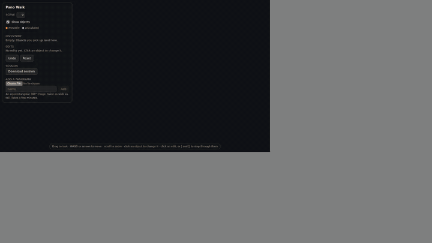
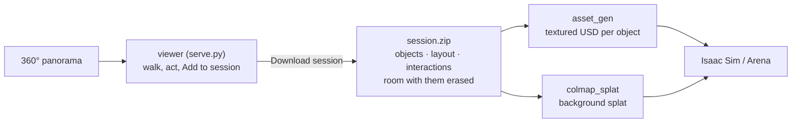

# sim/pano_ideate

Turn one 360° photo of a room into a simulation scene: act on its objects in the browser, then generate them as textured rigid bodies and the room around them as a Gaussian splat.





Every model runs on [Triton](../../services/triton/README.md): the viewer and `asset_gen` run anywhere that reaches it, a laptop included; only the splat training needs a GPU.

## Run it

1. Set up the model endpoints (below).
2. Start the viewer, open `http://localhost:8765` and add a panorama in the panel (~4 min).
   ```bash
   uv run sim/pano_ideate/serve.py
   ```
3. Click an object and give two prompts: the **action** (recorded in the session: "open the bin lid") and the **director prompt**, what the image editor changes ("bin lid opens, revealing an empty interior"; leave it empty and the VLM plans the edit from the action). **Add to session** keeps an object as it is. Then **Download session**.

   | Action | Director prompt |
   |---|---|
   | pick up the cup | erase the cup |
   | open the bin lid | bin lid opens, revealing an empty interior |
   | put the cup in the bin (from the inventory) | paint cup in the bin from the inventory |
   | close the bin lid | bin lid is closed, hiding the cup from view |
4. Generate the objects, ticking them in the checklist (~4 min each; [asset_gen](../asset_gen/README.md)).
   ```bash
   uv run sim/asset_gen/objects.py <scene>_session.zip
   ```
5. Generate the background on a machine with an NVIDIA GPU (~7 + 3 min; [colmap_splat](../colmap_splat/README.md#from-a-pano_ideate-session)).
   ```bash
   uv run sim/colmap_splat/from_pano.py <scene>_session.zip datasets/colmap_splat/<scene>
   uv run sim/colmap_splat/train.py datasets/colmap_splat/<scene> datasets/colmap_splat/<scene>/runs --floor
   ```

| Output | Where | What |
|---|---|---|
| Objects | `datasets/asset_gen/<scene>/objects/<asset>/model.usda` | a textured rigid body, origin at the centre of its base |
| Layout | `layout.json` in the zip | each object's x, y now (null if picked up and not put back) |
| Interactions | `interactions.json` in the zip | pick-ups, placements, state changes, in order, each with its action and director prompt |
| Background | `datasets/colmap_splat/<scene>/runs/.../scene.usda` | the room without the objects |

All in the scene frame: z up, metres, origin on the floor below the capture point.

Check before use:
- **Background:** open the zip's `background/pano.jpg`; an object left there (the export logs `WARNING: the <object> may still be in the background`) appears twice.
- **Objects:** open each one's `views/`; `--seed <n>` draws another.
- **Heights:** `layout.json` has no height, and an object seen in part (a chair behind a table) is sized to that part. Stand each asset on the surface below it.

## Model endpoints

| Variable | Default model | Used for | Licence |
|---|---|---|---|
| `VLM_ENDPOINT` | Qwen3.5-122B-A10B | listing objects, planning actions | Apache-2.0 |
| `EDIT_ENDPOINT` | Qwen-Image-Edit-2511 | end states, removing and placing objects | Apache-2.0 |
| `DEPTH_ENDPOINT` | moge-3-vitg | metric depth | MIT |
| `DETECT_ENDPOINT` | llmdet_large | finding objects | Apache-2.0 |
| `SEGMENT_ENDPOINT` | sam2.1-hiera-large | outlining objects | Apache-2.0 |

Leave a variable unset for the default model on the flywheel Triton (`triton.$SERVICE_HOST:$CADDY_PORT`, or `TRITON_URL`), or set it to another model name or a full URL, `https://<host:port>/v2/models/<model>`. Reach Triton as in [quickstart.md](../../quickstart.md) steps 1–3; to serve a model elsewhere, see [Triton](../../services/triton/README.md#serve-a-model).

## The viewer

| Do | How | Expect |
|---|---|---|
| Look, move, zoom | drag; WASD or arrows; scroll | within 0.4 m of the capture point (the circle; `--radius`): further, holes show |
| Act on an object | hover (movable orange, articulated cyan), click, type the action and the director prompt | ~30 s; ~1 s for a state seen before |
| Put back | pick it in the inventory, click where it goes, type the action and how it stands there | ~35 s |
| Keep an object as it is | its card: **Add to session** (again to take it out) | erased and generated like the others |
| Step through edits | click one, or `[` `]`; Undo, Reset | |
| Download session | the panel | ~30 s per group of nearby objects erased, plus a retry for each still seen |

Notes:
- The state is saved to `<scene>/edits/` after every edit and resumed on restart; Reset deletes it. `session.py <scene>` writes the zip without the viewer. `--host 0.0.0.0` serves other machines.
- An articulated object remembers each state's view, contents included: close the cupboard with the cup inside, open it, the cup is there.

## The steps by hand

The viewer runs these; run one by hand to check or redo it.

| Step | Command | Check |
|---|---|---|
| Depth and scene frame (~2 min) | `uv run sim/pano_ideate/depth.py datasets/pano_ideate/<scene>` | `depth/floor.png`: walls straight, floor flat |
| Objects (~1 min) | `uv run sim/pano_ideate/objects.py datasets/pano_ideate/<scene>` | `objects/labels.jpg` |
| An action's end state | `uv run sim/pano_ideate/act.py datasets/pano_ideate/<scene> "open the cupboard"` | `act/<action>/crops/` |
| The session zip | `uv run sim/pano_ideate/session.py datasets/pano_ideate/<scene>` | `background/pano.jpg` in it |

The panorama goes at `datasets/pano_ideate/<scene>/source.jpg`. The sample, `office`, is a Poly Haven HDRI (CC0):
```bash
mkdir -p datasets/pano_ideate/office && curl -fL -o datasets/pano_ideate/office/source.jpg \
  "https://dl.polyhaven.org/file/ph-assets/HDRIs/extra/Tonemapped%20JPG/poly_haven_studio.jpg"
```

Notes:
- The scale is MoGe's estimate (camera 1.2 m above the floor for `office`); `depth.py --camera_height <m>` sets it.
- Kinds: movable (could be picked up or carried, at most 1.5 m across and 1 cm thick: `--max_size`, `--min_thickness`), articulated (has a part to open, close or turn), static (the rest). Expect duplicates and odd labels; acting merges an object's entries.
- `objects.py --redetect` and `act.py --replan` ask the models again instead of reusing their cache.
